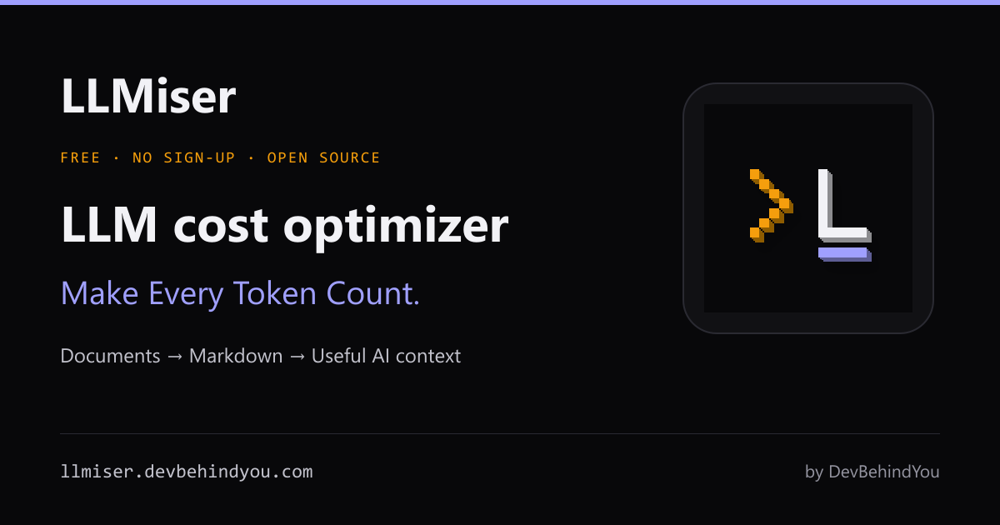

# LLMiser

**Make Every Token Count.**

LLMiser is a free **LLM cost optimizer for document inputs** by DevBehindYou. Convert PDFs, Office files, images and ZIP projects to editable Markdown, remove unnecessary context, and prepare useful input for AI assistants and RAG workflows.

[Open LLMiser](https://llmiser.devbehindyou.com) · [How it works](https://llmiser.devbehindyou.com/usecase) · [Privacy](https://llmiser.devbehindyou.com/privacy)



## Convert, refine, measure

1. Choose up to 20 documents and select Standard, Clean, Compact or RAG-ready.
2. Convert and review the output. Check OCR, tables and reading order, then remove irrelevant sections.
3. Copy Markdown, download `.md`, or export a ZIP. Compare actual model usage and answer quality in your AI workflow.

Supported inputs include PDF, DOCX, PPTX, XLSX, XLS, EPUB, HTML, CSV, TSV, JSON, XML, text, images and ZIP projects. Documents and ZIPs support up to 15 MB each. Images support up to 10 MB. Scanned PDFs support up to 100 scanned pages per file, and ZIPs up to 2,000 files.

## Cost transparency

Text token counts are rough estimates, not model-specific billing measurements. Actual savings depend on the model, tokenizer, input method and content. Native PDF ingestion and extracted text are different baselines. Markdown may lose visual information, so check quality as well as cost. LLMiser prepares document inputs; it does not route models, change provider pricing or promise a fixed percentage saving.

Files are uploaded for conversion. Private storage uses a default 48-hour retention period with documented administrative exceptions. See the Privacy Policy for details.

## Development

Requires Node.js 22. From `frontend`:

```sh
npm ci
npm run dev
npm test
npm run lint
npm run build
```

Copy `.env.example` to a local environment file and configure your own services. See the backend README files for conversion-service setup. Local credentials, caches and uploaded files are excluded from this repository.

## Rebranding and deployment

This repository starts from MDify commit `ce56f5c` and uses the selected **11 — Prompt L** icon kit. MDify and MDify-Pro remain separate and unchanged. Existing blog article sources and illustrations are preserved for independent editing.

The canonical origin is `https://llmiser.devbehindyou.com`. See [the migration runbook](docs/LLMISER_MIGRATION.md) for deployment, redirects and remaining hosting steps, and [implementation notes](docs/LLMISER_REBRAND.md) for compatibility details.

`npm run brand:images` rebuilds the social card from the approved icon. The brand kit and research archive are kept in a local, private `project-docs/` folder that is not part of this repository.

## License

GNU General Public License v3.0. See [LICENSE](LICENSE).

## AI agent handover

Read [docs/START_HERE.md](docs/START_HERE.md) for the current state, decisions and documentation index. The [handover](docs/ai-handover/HANDOVER.md) explains what changed and where. The [progress tracker](docs/ai-handover/PROGRESS.md) records completed and pending work.

The next content agent should use the [blog, banner and visual rebranding prompt](docs/ai-handover/BLOG_REBRAND_PROMPT.md). The app is ready locally; all eight articles, eight banners and forty figures still await their content rebrand. Deployment and live domain activation remain separate pending phases.
