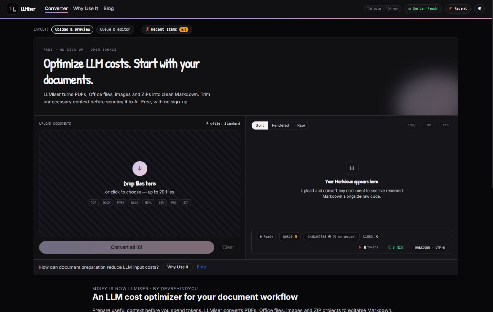
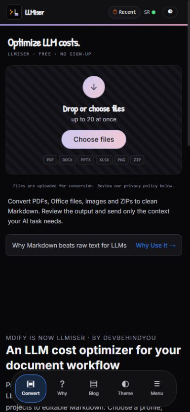
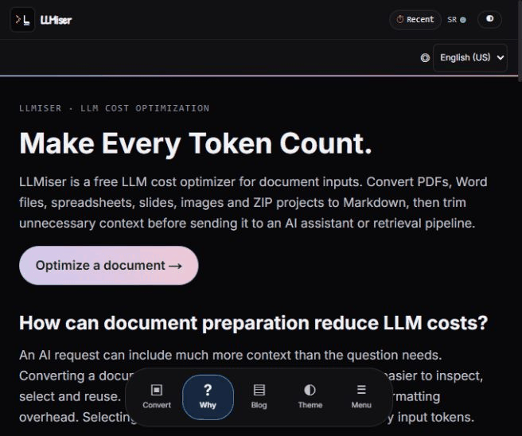

<p align="center">
  <a href="https://llmiser.devbehindyou.com">
    <picture>
      <source media="(prefers-color-scheme: dark)" srcset="frontend/public/llmiser-icon-dark.svg">
      
    </picture>
  </a>
</p>

<h1 align="center">LLMiser · Free PDF to Markdown Converter & LLM Cost Optimizer</h1>

<p align="center">
  <strong>Make Every Token Count.</strong><br>
  Turn documents, images and ZIP projects into editable Markdown.<br>
  Keep the context your AI needs. Leave the clutter behind.
</p>

<p align="center">
  <a href="https://llmiser.devbehindyou.com"><strong>Open LLMiser →</strong></a>
  &nbsp;·&nbsp;
  <a href="#how-to-convert-a-pdf-to-markdown">How to convert</a>
  &nbsp;·&nbsp;
  <a href="#see-llmiser-in-action">Screen demos</a>
  &nbsp;·&nbsp;
  <a href="#frequently-asked-questions">FAQ</a>
</p>

<p align="center">
  
  
  
  <a href="LICENSE"></a>
</p>

**LLMiser is a free online Markdown converter and LLM cost optimizer for document inputs.** Convert PDF to Markdown, Word to Markdown, spreadsheets, slides, images or a ZIP project; review the result, remove irrelevant sections and copy or download a `.md` file. No sign-up or software installation is needed to use the web app.

## See LLMiser in action



*Desktop: keep uploads and Markdown side by side. Switch between rendered output and raw Markdown as you review.*

<details>
<summary><strong>See the mobile converter</strong></summary>
<br>

<p>Choose files from your phone, review the conversion and download Markdown in the same app.</p>
</details>

<details>
<summary><strong>Watch the six-language interface demo</strong></summary>
<br>

<p>A local preview of the language selector and translated help screen. The app remembers your choice; blogs stay in English.</p>
</details>

## How to convert a PDF to Markdown

1. **Open [LLMiser](https://llmiser.devbehindyou.com).** Read the upload notice and accept the Terms and Privacy Policy when prompted.
2. **Drop your files or choose them.** Add a PDF, Office document, image or ZIP. Queue up to **20 files** at once.
3. **Choose an output profile.** Start with **Standard**; try **Clean**, **Compact** or **RAG-ready** for a different use case.
4. **Click Convert all.** Wait for the results. The first request after a quiet period may take longer while the converter starts.
5. **Review, edit and export.** Check headings, tables, OCR and reading order. Copy the Markdown, download a `.md` file, or export a batch ZIP.

Paste the relevant Markdown into ChatGPT, Claude, Gemini or another AI assistant, or keep it in your notes, wiki or documentation. Choose only the sections your question needs.

### A small conversion example

Imagine a document with a title, two action items and a table. Its Markdown can look like this:

```markdown
# Project brief

## Next steps
- Review the proposal.
- Confirm the launch date.

| Task | Owner |
| --- | --- |
| Review | Design team |
| Launch | Project lead |
```

*Illustrative output, not a conversion benchmark.* You can read and edit the structure directly, then keep the relevant section for your next prompt. Complex layouts may need corrections.

## What can you convert?

| Conversion | Supported inputs | Limit per file | Result |
| --- | --- | --- | --- |
| **PDF to Markdown / PDF to MD** | Text-based PDFs and scanned PDFs | 15 MB; up to 100 scanned pages | Editable text with recovered structure; scanned pages use OCR |
| **Word to Markdown** | DOCX | 15 MB | Document text, headings, lists and supported tables |
| **PowerPoint to Markdown** | PPTX | 15 MB | Slide text for notes, review and AI context |
| **Excel to Markdown** | XLSX, XLS | 15 MB | Spreadsheet content in a text-friendly format |
| **HTML to Markdown and text files** | HTML, HTM, EPUB, CSV, TSV, JSON, XML, TXT, MD, Markdown | 15 MB | Reusable Markdown or text, depending on the source |
| **Image to text / image to Markdown** | PNG, JPG, JPEG, WebP, TIF, TIFF, BMP, GIF | 10 MB | Recognized text as Markdown |
| **ZIP to Markdown** | Code projects and document folders | 15 MB upload; up to 2,000 entries | Combined Markdown, a project index and a manifest |

ZIP processing skips recognized dependency/build folders and credential-like files. These safeguards are not a secret detector: remove private files before uploading a project. Other archive safety limits also apply.

OCR quality depends on the scan and the recognition languages available on the service. Changing the interface language does not change the OCR language. Review small print, handwriting, equations and complex tables before using the result.

## Choose the Markdown that fits your task

| Profile | What changes | Good for |
| --- | --- | --- |
| **Standard** | Keeps the full result with a title and source note | Everyday conversion and checking the source |
| **Clean** | Removes the source note and extra blank lines | Notes, wikis and documentation |
| **Compact** | Also removes divider lines | Reducing formatting overhead in AI context |
| **RAG-ready** | Adds a chunk marker before section headings | Preparing documents for retrieval-augmented generation (RAG) |

RAG-ready prepares text for your next step; it does not build a knowledge base or guarantee better retrieval.

## Reduce LLM token usage with better document context

Long attachments can contain repeated headers, unrelated sections and formatting your question does not need. LLMiser makes that content easier to inspect and trim before you send it to an AI model.

- **Convert:** turn the document into editable Markdown.
- **Refine:** keep the facts, tables and sections your task needs.
- **Measure:** compare actual token usage and answer quality in your chosen AI tool.

Markdown can reduce unnecessary input, especially when the original workflow processes page images as well as text. It can also lose visual information. Keep the original PDF when charts, diagrams or page layout matter.

**No fixed savings promise:** the app's token count is a rough text estimate, not a billing meter. Actual costs depend on the model, tokenizer, input method and content. LLMiser does not change model pricing, route requests or bypass free-plan limits. [Read how document cost optimization works →](https://llmiser.devbehindyou.com/usecase)

## One app, six interface languages

**English (US) · Deutsch · 日本語 · Español · Русский · 简体中文**

Use the language selector in the app header. LLMiser remembers your selection on that browser. Converter controls, help and policy screens use your chosen language. Your uploaded documents and generated Markdown keep their original language; this is not document translation. Blog articles remain in English.

## Built for your next workflow

| If you are… | Use LLMiser to… |
| --- | --- |
| **A student** | Turn lecture slides or textbook sections into searchable study notes and focused AI context |
| **A researcher** | Review extracted text, keep source material readable and select relevant passages |
| **A writer or team** | Move document content toward Markdown notes, wikis, Obsidian, Notion or GitHub |
| **A developer** | Prepare structured document text or a ZIP project for AI review and RAG workflows |

## Your files and privacy

Files are **uploaded to LLMiser for conversion**. Conversion does not happen entirely on your device.

- No account is required.
- Uploads and results use private storage with a **default 48-hour retention period**. Cleanup runs periodically; administrative exceptions are described in the policy.
- LLMiser does not use your files for advertising or training machine learning models.
- Your browser keeps your last five conversion sessions (Markdown when it fits, file details and a recovery reference), plus language, theme and consent preferences. Clear saved conversions from **Recent**.
- Anonymous page-view analytics help us understand app usage.

Read the [Privacy Policy](https://llmiser.devbehindyou.com/privacy) and [Terms of Service](https://llmiser.devbehindyou.com/terms) before uploading sensitive material.

## Frequently asked questions

### How do I convert a PDF to Markdown for free?

Open [LLMiser](https://llmiser.devbehindyou.com), choose or drop the PDF, select a profile and click **Convert all**. Review the result, then copy it or download `.md`. Each document can be up to 15 MB; a batch can contain up to 20 files.

### Is PDF to MD the same as PDF to Markdown?

Yes. `.md` is a common file extension for Markdown. LLMiser produces editable Markdown you can copy, save or use as text input in other tools.

### Can I extract text from images or scanned PDFs?

Yes. LLMiser supports image-to-text OCR for supported image formats and scanned PDF pages. Images can be up to 10 MB; PDFs can be up to 15 MB with up to 100 scanned pages. Recognition is not perfect, so check the output against the original.

### Can it reduce ChatGPT or Claude token usage?

It can help you send less unnecessary context by converting documents to Markdown and letting you remove irrelevant sections. Savings vary with the AI tool and input method. The app's estimates do not measure provider billing or guarantee more messages on a free plan.

### Can I convert Word, Excel and PowerPoint files too?

Yes. Upload DOCX, XLSX, XLS or PPTX files, then review and export the Markdown. Older `.doc` and `.ppt` formats are not supported.

### Does the language selector translate my documents?

No. It changes the app interface. Your source content and converted Markdown retain their original language, and blogs remain English.

### Can I use the output in Obsidian, Notion or a RAG workflow?

You can copy or import Markdown where those tools support it. Check tables, images and formatting after import. RAG-ready adds section markers for downstream processing; you still choose your own indexing and retrieval workflow.

### Can I recover a finished conversion if its download fails?

Use **Retry download** or reopen the entry in **Recent** while the server result is still available. LLMiser can request fresh download links without uploading and converting the file again. A cached Markdown copy can still open after the server files are deleted. Export your edits separately from the original output files.

### What should I do if the first conversion is slow?

Give the converter time to start after an idle period and watch the status indicator. If it reports an error, retry when the service is available. Keep a copy of the original and download results you want to save.

## Open source, made by DevBehindYou

LLMiser is maintained by **[DevBehindYou](https://github.com/DevBehindYou)** and licensed under the **[GNU General Public License v3.0](LICENSE)**. Open the app at [llmiser.devbehindyou.com](https://llmiser.devbehindyou.com).

Found a bug or have an idea? [Open an issue](https://github.com/DevBehindYou/LLMiser/issues) or contact [devbehindyou@gmail.com](mailto:devbehindyou@gmail.com). Avoid attaching private documents or credentials to public issues.

The [Chrome extension development build](extension/README.md) offers a single file Converter popup, AI-site detection and a manual Paste button. It is not published in the Chrome Web Store; native acceptance remains pending.

Developer and AI-agent setup notes live in [docs/START_HERE.md](docs/START_HERE.md). Keyword evidence and editorial choices are recorded in [the README research notes](docs/README_KEYWORD_RESEARCH.md).

<p align="center"><a href="https://llmiser.devbehindyou.com"><strong>Drop a document. Review the Markdown. Make every token count. →</strong></a></p>
