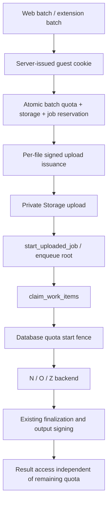

# Guest quota audit

11 November 2026. Local baseline: `fb38df3`. Source inspection only: production schema, dashboards and deployment are not verified. The original Downloads prompt is no longer present; MASTER_PROMPT.md records the corrected implementation contract from the reviewed text.

## Acceptance graph

Existing entry points: `frontend/app/api/uploads/create/route.js`, `api/convert`, `api/jobs/[id]/start`, `advance`, `download`, authenticated tick and admin routes. `jobService.js` calls `create_reserved_upload_job`; that transaction already enforces storage forecasts and the 32-active-root ceiling. `publicAdmission.js` adds global and keyed-IP request budgets, not a daily file quota. `supabaseRest.js` uses service-role PostgREST, not a direct SQL connection. Workers require the shared backend secret. Anonymous REST/RPC privileges remain revoked.

The extension already uploads files; its transport previously omitted credentials. Web and extension must bootstrap the same host cookie, send credentials only to the canonical app, and reserve full selections before upload. An extension update and native browser acceptance are required before enabling enforcement. Old clients receive a structured update-required error, never a bypass.

## Decisions

- DB policy is the enforcement switch, default disabled. All server entry points consult it; unknown policy fails closed. Schema must be applied before frontend deployment.
- Guest 20, rolling 24 hours from admission. A reserved file occupies a slot immediately. First durable worker claim commits `started`; completed/failed processing never refunds. Pending slots expire after three hours; expired slots cannot claim workers. No worker page/ZIP child charges.
- Entire batch reserves atomically, including existing storage/active-job checks. Insufficient quota rejects all files. User removes files and resubmits; no partial implicit conversion.
- Manifest-bound UUID idempotency key returns original jobs. Different manifest with same key is a conflict. Storage signing/HTTP uncertainty retains reservations for safe replay.
- Upload signing is restricted to 45 minutes after admission, preserving the existing three-hour storage guard for two-hour signed URLs. Replays can resume an existing upload without issuing another upload URL.
- Protected ledger has no cascading job FK: deleting results must not refund charged usage. Existing UUID-capability result retrieval is preserved. Quota identity does not silently become document ownership or account membership.
- A separate server secret signs guest cookies and hashes tokens. Cookie clearing creates a new identity; global abuse controls remain. No person-level guarantee.
- Same-subject locking serializes reservations, releases and first worker charge. Read database clock after the lock. No raw cookies, file contents or signed URLs in logs.
- Direct multipart processing is disabled with a structured use-storage response while quota enforcement is enabled. Requests already carrying body bytes cannot be retroactively stopped at the network edge.
- Shared policy activation must not grandfather newly created unmetered jobs. Only jobs predating initial activation retain legacy processing access.
- Account promotion, passwords and SMTP remain design-only. Future usage merge must preserve distinct events and cannot grant result access on a shared browser.

## Risks and evidence gates

Use real PostgreSQL multi-connection concurrency tests in addition to PGlite. Test fresh-cookie multi-tab bootstrap, extension cookie behavior, blocked cookies, signed-URL replay after reservation expiry, processing/cleanup races, lost HTTP responses, differing-manifest replay, existing result retrieval and all six UI languages. Keep feature disabled until native extension and production migration checks pass. No production load tests or account/email activation are authorized by this rollout.

48-hour default document retention and KEEP/EXTEND remain intact. Existing storage admission keeps the three-hour guard independently of quota release. Ledger expiry is not permission to delete Storage objects or alter retained results.
