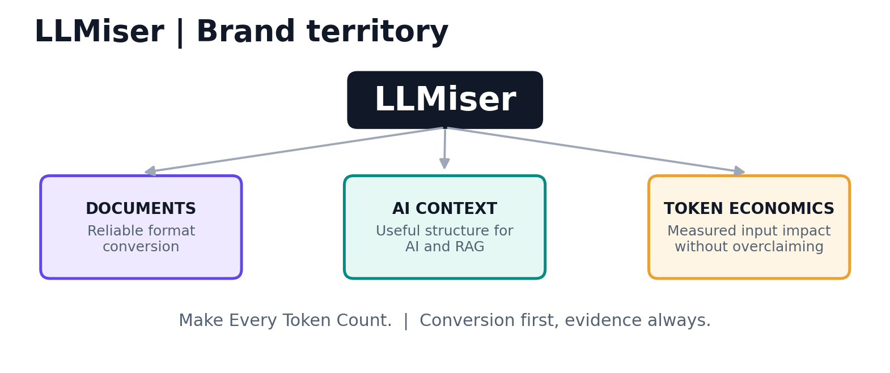

# 01 — Brand, mission, context, vision and audiences

## Brand architecture

**Name:** LLMiser · **Descriptor:** AI-ready document-to-Markdown converter · **Motto:** **Make Every Token Count.**

**One-line explanation:** `LLMiser converts documents and webpages into structured Markdown for AI workflows, helping users avoid needless context clutter and evaluate token costs.`

**Vision (long-term):** Make useful, verifiable context easier and more affordable to prepare for every AI interaction.

**Mission (what exists/near term):** Provide dependable, transparent document conversion, readable output, privacy-conscious workflow design, and honest information on fidelity and potential token impact.

**Brand promise:** `Useful structure, fewer distractions, honest measurements.` Not “guaranteed 70% cheaper AI” and not “lossless conversion of any file.”

**Positioning statement:** For developers, analysts and AI power users who spend time cleaning documents before asking an LLM to use them, LLMiser is an approachable document-to-Markdown utility that combines multiple file formats, batch/ZIP workflows and AI-context guidance; unlike a bare generic converter, it provides targeted education, transparent format limitations and (once implemented) reproducible token comparisons.

## Audience segmentation

| Segment | Job to be done | Trigger | Useful product proof | Primary discovery |
|---|---|---|---|---|
| AI application engineers / RAG builders | Prepare structured inputs for embedding, chunking and retrieval | Scanned or complex PDF ingestion | Table/heading fidelity examples, OCR failure modes, ZIP export integrity | GitHub, technical SEO, Reddit r/Rag |
| ChatGPT/Claude power users | Convert a document before pasting useful sections into chat | Context window or messy copy/paste | Before/after Markdown examples; honest model-dependent token math | Google/Bing queries, AI answers |
| Researchers / students | Transform papers, citations and scans into editable structured notes | PDF research review | Math/reading-order limits and sample outputs | Conversion searches, research workflows |
| Developers / codebase analysts | Bundle project folders or ZIPs into a text artifact | Code context preparation | Nested archive limits, exclusions, test fixtures, secret caution | GitHub, ZIP-to-Markdown keywords |
| Writers / knowledge workers | Move Word, HTML, web pages to Markdown editors | Documentation publishing | Working DOCX/HTML conversion and preview | Search, Chrome Web Store |
| Teams with sensitive documents | Assess privacy and retention before upload | Concern about uploads/retention | Clear server-side processing and retention disclosure; honest Chrome local mode | Privacy-comparison searches |

**Negative / weak-fit audience:** people primarily seeking an API cost observability dashboard, LLM router, model fine-tuning service, or guaranteed prompt compression. Do not pursue their keywords with conversion-page copy until corresponding product functionality exists.

## Messaging hierarchy

1. **Task:** Convert documents to structured Markdown.
2. **Workflow:** Reuse Markdown in ChatGPT, Claude, Gemini, notebooks and RAG pipelines.
3. **Practical value:** Less conversion friction, cleaner headings/lists, potentially less avoidable context overhead.
4. **Proof:** Measured output fidelity and tokenizer-specific comparisons, with original sample documents and conditions.
5. **Trust:** Free/no sign-up status as currently advertised, retention details, open-source repo, honest caveats.

## H1, title and messaging variants

- Primary home H1: `Turn Documents into AI-Ready Markdown.`
- Conversion-led H1 A/B candidate: `Convert PDF, Word and Images to Markdown.`
- Primary tagline: `Make Every Token Count.`
- Alternate tagline (product-first): `Better Documents. Better AI Context.`
- Technical tagline (developer page): `From messy files to structured context.`
- Homepage SEO title: `LLMiser — Free Document to Markdown Converter for AI`
- Search description: `Convert PDF, Word, Excel, PowerPoint, images and ZIP files into structured Markdown for AI assistants and RAG workflows. Free, with no sign-up.` **Verify the live feature and policy claims at publish time.**

## Naming nuances

“LLMiser” includes “LLM,” which strengthens AI relevance but can be pronounced awkwardly and “miser” can sound stingy. Test pronunciation and recall with 5–10 people unfamiliar with the brand. Use `LLMiser` in all copy and `LLMiser – Document to Markdown` in directory listings, never alternate randomly among `LL Miser`, `LLM Iser` and `LLMizer`.

## Six-month vision vs capability truth

| Already described publicly in MDify | Proposed, **not yet present / not verified** |
|---|---|
| PDF, DOCX, PPTX, XLSX, images/OCR, ZIP, HTML, preview and MD/ZIP export | Model-specific token calculator with exact tokenizers |
| Up to 20 files, no account, 48h storage retention shown on public homepage | Public document conversion benchmark dashboard |
| AI-ready profiles / RAG use cases in product messaging | Production Chrome extension with webpage-local extraction |
| Existing eight blog posts about LLM token costs | API, local-first document conversion, automated context compression, enterprise integrations |

The first column is public-facing description, **not independent proof of every conversion edge case**. Preserve that distinction in marketing.

## Product narrative

The real problem is not only “PDFs have too many tokens.” PDF handling depends on whether a model gets raw bytes, extracted text, image pages, a native PDF attachment or an indexed retrieval representation. LLMiser offers a structured intermediary—Markdown—and teaches users to evaluate its usefulness for a particular task. It should neither discard crucial tables to chase a low token count nor claim every Markdown file improves answer quality.

## Decision gates

- Brand registration and trademark conflict checks **pass**.
- Brand and homepage copy is reviewed for accurate claims.
- The old MDify domain and linked routes can be preserved through redirects.
- Search baseline and operational metrics are captured before switching.
- The legal/privacy disclosures represent actual processing locations and retention behavior.

**Primary sources:** [MDify live product](https://mdify.devbehindyou.com/), [Google site names guidance](https://developers.google.com/search/docs/appearance/site-names), [2026 RAG evaluation study](https://arxiv.org/abs/2604.04948).
