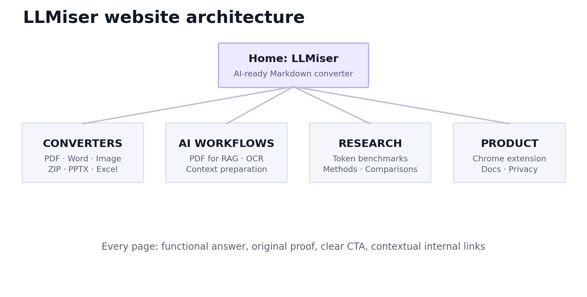

# 05 — Site information architecture, H1s, SEO metadata and snippets



## Page-by-page architecture

**Proposed base:** `https://llmiser.com` — this is hypothetical until registration/ownership is confirmed.

| Path | Primary keyword | H1 (one only) | Suggested page title | Status |
|---|---|---|---|---|
| `/` | document to markdown converter | Turn Documents into AI-Ready Markdown | LLMiser — Free Document to Markdown Converter for AI | Day 1 |
| `/pdf-to-markdown` | PDF to Markdown converter | Convert PDF to Markdown Online | PDF to Markdown Converter — Free Online Tool \| LLMiser | P0 |
| `/word-to-markdown` | Word to Markdown converter | Convert Word Documents to Markdown | Word to Markdown Converter — DOCX to MD \| LLMiser | P0 |
| `/image-to-markdown` | image to Markdown converter | Convert Images to Markdown with OCR | Image to Markdown Converter with OCR \| LLMiser | P0 |
| `/scanned-pdf-to-markdown` | scanned PDF to Markdown | Convert Scanned PDFs to Markdown | Scanned PDF to Markdown OCR Converter \| LLMiser | P0, unique OCR UX |
| `/zip-to-markdown` | ZIP to Markdown converter | Convert ZIP Projects to Markdown | ZIP to Markdown Converter for AI Workflows \| LLMiser | P0 |
| `/pdf-to-markdown-for-rag` | PDF to Markdown for RAG | Prepare PDFs for RAG with Markdown | PDF to Markdown for RAG Pipelines \| LLMiser | P1, technical guide |
| `/pdf-to-markdown-for-llms` | PDF to Markdown for LLMs | Prepare PDFs for LLMs | PDF to Markdown for LLMs: Workflow & Limitations \| LLMiser | P1, educational |
| `/powerpoint-to-markdown` | PowerPoint to Markdown | Convert PowerPoint to Markdown | PowerPoint to Markdown Converter \| LLMiser | P1 |
| `/excel-to-markdown` | Excel to Markdown | Convert Excel to Markdown | Excel to Markdown Converter \| LLMiser | P1 |
| `/html-to-markdown` | HTML to Markdown | Convert HTML to Markdown | HTML to Markdown Converter \| LLMiser | P1 |
| `/batch-to-markdown` | batch Markdown converter | Convert Multiple Files to Markdown | Batch Markdown Converter \| LLMiser | P1, genuine distinct batch UX |
| `/chrome-extension` | webpage to Markdown Chrome extension | Convert Webpages to Markdown in Chrome | Webpage to Markdown Chrome Extension \| LLMiser | Only after tested launch |
| `/research/pdf-vs-markdown-tokens` | PDF vs Markdown tokens | PDF vs Markdown: Measured Input-Token Costs | PDF vs Markdown Tokens: Reproducible Benchmark \| LLMiser | After actual experiments |
| `/tools/token-calculator` | LLM token calculator | Compare Token Counts Before You Send | LLM Token Comparison Calculator \| LLMiser | **Not before feature release** |

## Model homepage copy

**Eyebrow:** `FREE · AI-READY MARKDOWN · NO SIGN-UP` (only if still true at launch)

**H1:** `Turn Documents into AI-Ready Markdown.`

**Subheading:** `Convert PDFs, Word files, presentations, spreadsheets, images and ZIP projects into structured Markdown for ChatGPT, Claude, Gemini and RAG workflows.`

**Main CTA:** `Convert a file` · **Second CTA:** `Explore token-efficiency research` (only if evidence exists).

**Trust strip:** Supported formats; conversion limits; file processing/storage location; deletion policy; open-source link. **Do not write “Processed entirely in your browser”** for server-mediated PDF/OCR/ZIP conversion.

**First substantive heading:** `How LLMiser Works` followed by three steps: choose file → inspect Markdown → copy/download. Then examples of headings and tables, who it helps, supported formats, limitations, privacy and real FAQ answers.

## Format-page on-page template

- `<title>`: specific format and core use (avoid overlong duplicated suffixes).
- Description: format, available OCR/batch caveat and value proposition; no fabricated speed/savings.
- H1: `Convert [format] to Markdown`.
- Above fold: working converter preconfigured for correct file type, not a fake CTA.
- H2: `How to convert [format] to Markdown` with 3–5 steps.
- H2: `What the output preserves` with a sample `.md` preview and explicit exceptions.
- H2: `Scanned files, tables and known limitations` if applicable.
- H2: `Using the Markdown with AI` with appropriate caution about costs.
- H2: `FAQ` with 3–5 user questions naturally answered.
- Internal links: source format, adjacent format, RAG guide and research benchmark.
- Bottom CTA: functional conversion widget or clearly identified link to converter.

## Schema strategy

Use `WebSite` + `Organization` (factual owner) on home; `SoftwareApplication`/`WebApplication` only when the properties describe the real tool; `BreadcrumbList` for navigational pages; `Article` for real articles. Avoid unsupported fake ratings, prices, review counts and fabricated FAQ rich-result promises.

Example **illustrative** WebSite markup (replace with actually purchased domain):

```json
{
  "@context": "https://schema.org",
  "@type": "WebSite",
  "name": "LLMiser",
  "url": "https://llmiser.com/",
  "description": "Document to Markdown conversion for AI workflows"
}
```

Google's [site-name guidance](https://developers.google.com/search/docs/appearance/site-names) advises consistent brand usage and `WebSite` structured data at domain root. Validate canonical, site name and sitemap after migration.

## Snippet and internal-link architecture

On each educational page, place the exact question in a sensible H2 and answer in one clear paragraph before extended detail. Add user-friendly lists and tables. Google may or may not choose it as a [featured snippet](https://developers.google.com/search/docs/appearance/featured-snippets).

Link topology:

- Home → format conversion hub → individual converter pages.
- Format pages → matching tutorials and benchmark examples.
- RAG guide → PDF tool, OCR page, table fidelity research, ZIP converter.
- Chrome page → webpage conversion guide, homepage; clear extension-vs-web-API distinctions.
- Research → public methods/raw fixtures and precise model names, dates, limitations.

## Technical baseline checklist

- SSR/static-rendered indexable titles/body copy in Next.js (don't hide all useful text inside a client-only converter).
- `200` for canonical landing pages, unique title/H1, self-referential canonical, sitemap including only indexable URLs.
- Noindex upload/session/result/admin/private states. Never expose private file outputs in public metadata.
- Inspect `robots.txt`, `X-Robots-Tag`, redirects, mobile viewport, image alt text and Core Web Vitals.
- Accessible form labels, clear progress/errors, copy/download keyboard interactions and sensible live-region announcements.
- No duplicate English pages with superficial adjective differences.
- Avoid mixing a domain move with architecture rewrites or a massive content replacement at once.

Primary sources: [Google AI Optimization](https://developers.google.com/search/docs/fundamentals/ai-optimization-guide), [Google Site Move](https://developers.google.com/search/docs/crawling-indexing/site-move-with-url-changes), [Google helpful content](https://developers.google.com/search/docs/fundamentals/creating-helpful-content).
