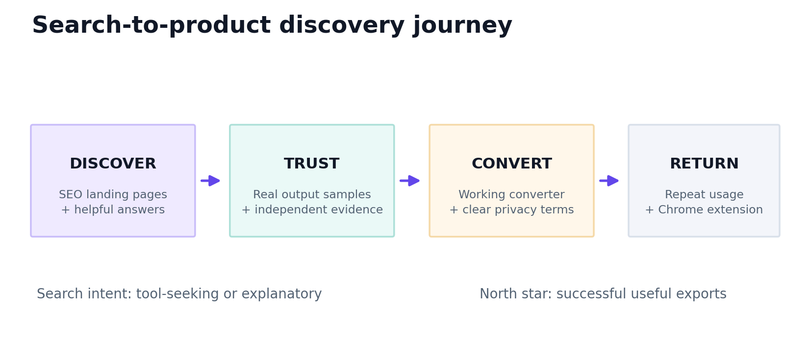

# 09 — SEO/GEO measurement and reporting scorecard

## Measurement is not guessing

**Search volume** means estimated average searches for a query in a defined country/language/device/period, from a named measurement tool; it is **not** page impressions, clicks, or keyword interest on Reddit. **Domain Rating** is Ahrefs' third-party 0–100 backlink-profile metric; it is not Google's ranking score. Neither was verified for the named competitors here. [Google Keyword Planner](https://support.google.com/google-ads/answer/7337243?hl=en); [Ahrefs DR](https://ahrefs.com/blog/domain-rating/).

## Baseline dashboard specification

| KPI | Definition / numerator | Owner | Source | Cadence |
|---|---|---|---|---|
| Organic clicks | Search Console non-paid clicks, by URL and country | SEO | GSC | Weekly |
| Organic impressions | GSC impressions, brand/nonbrand segmented | SEO | GSC | Weekly |
| CTR / average position | GSC values; segment by device | SEO | GSC | Weekly |
| Landing indexability | Canonical URL valid, not blocked and indexed | SEO/dev | GSC inspection & crawl | Weekly |
| Search conversion rate | `successful MD exports from organic sessions / organic sessions` | Product | Privacy-safe analytics | Weekly |
| Conversion success | `successful completed conversions / started conversions` | Engineering | Internal aggregate events | Daily |
| p95 conversion latency | End-to-end elapsed time for completed conversions by format | Engineering | Aggregate metrics | Daily |
| Batch/ZIP retrieval integrity | Tested exact-byte downloaded result and all parts | Engineering | E2E | Every PR/release |
| Branded query share | LLMiser vs MDify query impressions, each separately | SEO | GSC | Monthly |
| New format-page click share | Clicks from page cluster | SEO | GSC | Monthly |
| Google generative AI impressions | URLs surfaced in AI experiences if provided | SEO | GSC AI report | Monthly |
| Bing AI cited pages | Cited pages/grounding terms, if eligible | SEO | Bing AI Performance | Monthly |
| Manual answer citation rate | `mentions citing LLMiser / sampled prompts` | SEO | Logged sampling protocol | Monthly |
| Exact competitor DR | Named domain scope, tool timestamp | SEO | Licensed Ahrefs export | Quarterly |
| Keyword search volume | Geographic monthly volume + month | SEO | Planner/Ahrefs/Semrush | Quarterly |

**Privacy:** aggregate events such as `conversion_started`, `conversion_succeeded`, `download_succeeded` and format category can be useful, but never put uploaded text, file contents, signed URLs or credentials into analytics/logs. Check consent, legal basis, retention and data contracts before implementing analytics.

## Baseline & 90-day dashboard example — blank by design

| Metric | Pre-move MDify baseline | Week 1 | Day 30 | Day 90 | Target methodology |
|---|---:|---:|---:|---:|---|
| Organic clicks | — | — | — | — | Watch migration regressions |
| Organic branded clicks | — | — | — | — | Track MDify to LLMiser transition |
| Indexable canonical URLs | — | — | — | — | New mapped URL coverage |
| PDF page organic exports | — | — | — | — | Conversion rather than empty visits |
| 4xx/5xx conversion rate | — | — | — | — | Operational target after baseline |
| Google AI impressions | — | — | — | — | Report if data exists |
| Bing cited URLs | — | — | — | — | Report if available |

**No numeric promise is set before baseline data.** Use agreed guardrails such as “do not launch if converter E2E fails” and “urgent fix if legacy mapping unexpectedly generates 404s.”

## Tool protocols

1. Export GSC data from both properties **without overwriting old snapshots**; segment country/device, generic/branded, top URLs and query intent.
2. Export Google Planner volume for US, India and global English, capturing date range, units and match definition. Search-volume ranges do not equal precise demand.
3. Export Ahrefs domain-scope DR and top organic ranking URLs; use identical export date and top-level domain logic across competitors.
4. Log manual AI prompts with identical model/query where possible; separate brand mention from correct, clickable **citation**.
5. Reprioritize content using real data and conversion impact; delete/merge thin pages rather than adding random variants.

## Decision rules

- **Problem: branded clicks drop immediately after move.** Check redirects, canonicals, old host, sitemap and coverage before rewriting content.
- **Problem: high impressions, low clicks.** Review page intent and snippets. Do not chase CTR at expense of clarity.
- **Problem: organic users visit but cannot export.** Fix upload/preview/download UX and backend errors before publishing additional SEO pages.
- **Problem: AI citations without product usage.** Add truthful, visible CTA or improved task fit—not invented citations.
- **Problem: weak ranking for broad PDF converter.** Analyze narrower scanned/ZIP/RAG intent and useful original evidence.
