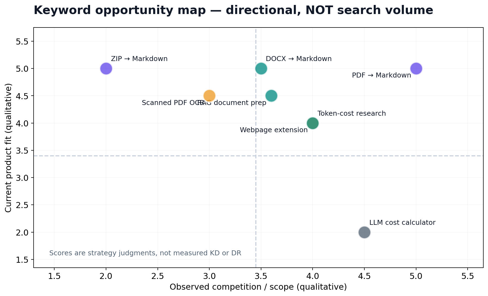
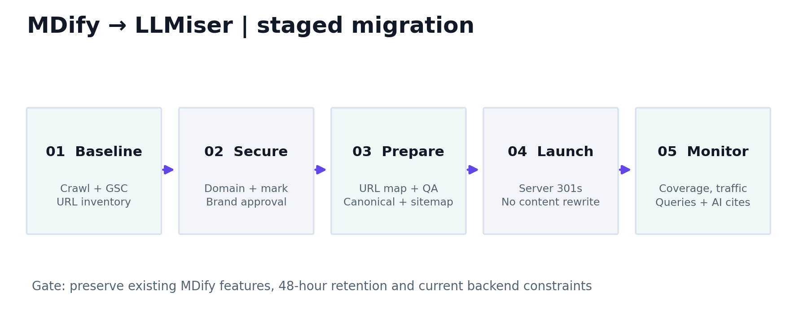

# LLMiser — Complete Combined Brand, SEO & GEO Research Guide

**Research baseline:** 18 October 2026. **Source:** 16 Markdown chapters.

All visuals referenced below are stored in the adjacent `assets/` directory. Detailed sources and uncertainty are included in chapter 11.


---


# LLMiser — brand, SEO and AI-search growth dossier

**Prepared:** 18 October 2026 · **Status:** strategic recommendation; *LLMiser is not yet a confirmed/cleared brand or registered domain*.  
**Predecessor:** [MDify](https://mdify.devbehindyou.com/) by DevBehindYou.  
**Audience:** founder, designers, developers, SEO leads, content team, and coding agents.


## Executive decision

**Recommended brand:** **LLMiser** (pronounced *L-L-Miser*). **Tagline:** *Make Every Token Count.*

**Product definition:** A free, AI-ready document-to-Markdown converter that helps users turn PDFs, Office files, images, and ZIP projects into useful, structured input for AI assistants and RAG workflows. The planned Chrome extension will convert webpages and selections locally. **The current product is not a general-purpose model proxy, prompt compressor, or guaranteed LLM bill reducer.**

**H1:** `Turn Documents into AI-Ready Markdown.`  
**Proof-oriented subheading:** `Convert PDFs, Word files, spreadsheets, images and ZIP projects into structured Markdown for AI assistants and RAG workflows. Measure token impact before making cost claims.`

**Brand success criterion:** users can reliably convert content, understand document quality and its limitations, and return for repeated use—not merely see rankings for the new brand.

## What's inside

| File | What it answers |
|---|---|
| [01 — Brand strategy](01_BRAND_STRATEGY.md) | Vision, mission, positioning, audience, messaging, tone, claim boundaries |
| [02 — Market and community evidence](02_MARKET_INTELLIGENCE.md) | Google/Bing, Reddit, Quora limits, GitHub, research literature |
| [03 — Keyword research](03_KEYWORD_RESEARCH.md) | Clusters, priority, intent, target pages, monthly-volume collection |
| [04 — Competitor and gap analysis](04_COMPETITOR_GAP_ANALYSIS.md) | Competitor capabilities, search surface and evidence-based gaps |
| [05 — SEO site architecture](05_SEO_INFORMATION_ARCHITECTURE.md) | Slugs, H1, titles, metadata, on-page specs, internal links |
| [06 — GEO / AI search](06_GEO_AI_SEARCH.md) | Google AI, ChatGPT, Bing/Copilot, grounding and measurement |
| [07 — Migration runbook](07_REBRANDING_MIGRATION.md) | Safe domain/brand change and SEO migration |
| [08 — Content calendar](08_CONTENT_CALENDAR.md) | Six-month topic/publishing roadmap and briefs |
| [09 — Metrics](09_MEASUREMENT_SCORECARD.md) | Definitions, realistic KPIs, experiments and export protocols |
| [10 — Execution prompt](10_AGENT_MASTER_PROMPT.md) | Full, reusable Codex/developer prompt |
| [11 — Sources and limitations](11_SOURCE_REGISTER.md) | Linked primary sources and evidence quality |
| [12 — Competitor DR register](12_COMPETITOR_DR_REGISTER.md) | Competitor domains and DR/traffic blanks awaiting verified export |
| [13 — Visual identity](13_BRAND_STYLE_GUIDE.md) | Name usage, voice, colors, accessibility and assets |
| [14 — UX and CRO](14_CRO_UI_UX.md) | Product funnel, conversion-page UX, measurement |
| [15 — Risks and claim policy](15_LEGAL_AND_CLAIMS.md) | Trademarks, user data, claims, migration and publication risks |

Visual files in [`assets/`](assets/) are included in the Markdown documents and embedded into the companion DOCX.

## Evidence conventions (read before using any table)

- **Observed**: confirmed in a linked public page at research time, or in MDify's user-provided handover.
- **Community signal**: Reddit user report or request; directional only, not statistically representative.
- **Inference / proposed**: strategic hypothesis, recommended positioning, page or feature.
- **Not verified**: no accessible first-party data; do not convert into a fabricated metric.
- **Monthly volume, Keyword Difficulty, Ahrefs Domain Rating, and competitor traffic:** **not independently verified**. They are explicitly left as `—` pending Google Keyword Planner/Ahrefs/Semrush exports, geography and date selection.

## Scope and constraints

Use the publicly released MDify implementation as the migration baseline. Keep the current conversion flows, Supabase and specialized N/O/Z backends, user-facing privacy/retention rules (48 hours subject to documented KEEP/EXTEND semantics), and review/CI gates. The uploaded 18 October 2026 handover describes newer PRs and diverged private/public repositories; **verify current Git HEAD and deploy state before touching code**. The new brand/domain decision does not authorize a risky backend refactor.

## Sequence

1. Conduct domain, app-store name and trademark clearance; get explicit owner sign-off.
2. Export 3–6 months of MDify Search Console data, current sitemap, all URL paths and page-wise conversions.
3. Buy/verify destination domain (illustrative URL `https://llmiser.com`, **not confirmed available**).
4. Build the same functioning web app with updated names, structured data and URL mapping; complete tests.
5. Perform domain move with server-side 301/308 redirects and monitor both properties.
6. Publish prioritized conversion pages; then publish original RAG/token research and the validated extension.

**Suggested initial goals:** protect MDify's existing conversions and organic traffic, establish branded search impressions, grow successful downloads, and generate attributable AI-search citations. No guaranteed rankings or traffic targets.


---


# 01 — Brand, mission, context, vision and audiences


## Brand architecture

**Name:** LLMiser · **Descriptor:** AI-ready document-to-Markdown converter · **Motto:** **Make Every Token Count.**

**One-line explanation:** `LLMiser converts documents and webpages into structured Markdown for AI workflows, helping users avoid needless context clutter and evaluate token costs.`

**Vision (long-term):** Make useful, verifiable context easier and more affordable to prepare for every AI interaction.

**Mission (what exists/near term):** Provide dependable, transparent document conversion, readable output, privacy-conscious workflow design, and honest information on fidelity and potential token impact.

**Brand promise:** `Useful structure, fewer distractions, honest measurements.` Not “guaranteed 70% cheaper AI” and not “lossless conversion of any file.”

**Positioning statement:** For developers, analysts and AI power users who spend time cleaning documents before asking an LLM to use them, LLMiser is an approachable document-to-Markdown utility that combines multiple file formats, batch/ZIP workflows and AI-context guidance; unlike a bare generic converter, it provides targeted education, transparent format limitations and (once implemented) reproducible token comparisons.

## Audience segmentation

| Segment | Job to be done | Trigger | Useful product proof | Primary discovery |
|---|---|---|---|---|
| AI application engineers / RAG builders | Prepare structured inputs for embedding, chunking and retrieval | Scanned or complex PDF ingestion | Table/heading fidelity examples, OCR failure modes, ZIP export integrity | GitHub, technical SEO, Reddit r/Rag |
| ChatGPT/Claude power users | Convert a document before pasting useful sections into chat | Context window or messy copy/paste | Before/after Markdown examples; honest model-dependent token math | Google/Bing queries, AI answers |
| Researchers / students | Transform papers, citations and scans into editable structured notes | PDF research review | Math/reading-order limits and sample outputs | Conversion searches, research workflows |
| Developers / codebase analysts | Bundle project folders or ZIPs into a text artifact | Code context preparation | Nested archive limits, exclusions, test fixtures, secret caution | GitHub, ZIP-to-Markdown keywords |
| Writers / knowledge workers | Move Word, HTML, web pages to Markdown editors | Documentation publishing | Working DOCX/HTML conversion and preview | Search, Chrome Web Store |
| Teams with sensitive documents | Assess privacy and retention before upload | Concern about uploads/retention | Clear server-side processing and retention disclosure; honest Chrome local mode | Privacy-comparison searches |

**Negative / weak-fit audience:** people primarily seeking an API cost observability dashboard, LLM router, model fine-tuning service, or guaranteed prompt compression. Do not pursue their keywords with conversion-page copy until corresponding product functionality exists.

## Messaging hierarchy

1. **Task:** Convert documents to structured Markdown.
2. **Workflow:** Reuse Markdown in ChatGPT, Claude, Gemini, notebooks and RAG pipelines.
3. **Practical value:** Less conversion friction, cleaner headings/lists, potentially less avoidable context overhead.
4. **Proof:** Measured output fidelity and tokenizer-specific comparisons, with original sample documents and conditions.
5. **Trust:** Free/no sign-up status as currently advertised, retention details, open-source repo, honest caveats.

## H1, title and messaging variants

- Primary home H1: `Turn Documents into AI-Ready Markdown.`
- Conversion-led H1 A/B candidate: `Convert PDF, Word and Images to Markdown.`
- Primary tagline: `Make Every Token Count.`
- Alternate tagline (product-first): `Better Documents. Better AI Context.`
- Technical tagline (developer page): `From messy files to structured context.`
- Homepage SEO title: `LLMiser — Free Document to Markdown Converter for AI`
- Search description: `Convert PDF, Word, Excel, PowerPoint, images and ZIP files into structured Markdown for AI assistants and RAG workflows. Free, with no sign-up.` **Verify the live feature and policy claims at publish time.**

## Naming nuances

“LLMiser” includes “LLM,” which strengthens AI relevance but can be pronounced awkwardly and “miser” can sound stingy. Test pronunciation and recall with 5–10 people unfamiliar with the brand. Use `LLMiser` in all copy and `LLMiser – Document to Markdown` in directory listings, never alternate randomly among `LL Miser`, `LLM Iser` and `LLMizer`.

## Six-month vision vs capability truth

| Already described publicly in MDify | Proposed, **not yet present / not verified** |
|---|---|
| PDF, DOCX, PPTX, XLSX, images/OCR, ZIP, HTML, preview and MD/ZIP export | Model-specific token calculator with exact tokenizers |
| Up to 20 files, no account, 48h storage retention shown on public homepage | Public document conversion benchmark dashboard |
| AI-ready profiles / RAG use cases in product messaging | Production Chrome extension with webpage-local extraction |
| Existing eight blog posts about LLM token costs | API, local-first document conversion, automated context compression, enterprise integrations |

The first column is public-facing description, **not independent proof of every conversion edge case**. Preserve that distinction in marketing.

## Product narrative

The real problem is not only “PDFs have too many tokens.” PDF handling depends on whether a model gets raw bytes, extracted text, image pages, a native PDF attachment or an indexed retrieval representation. LLMiser offers a structured intermediary—Markdown—and teaches users to evaluate its usefulness for a particular task. It should neither discard crucial tables to chase a low token count nor claim every Markdown file improves answer quality.

## Decision gates

- Brand registration and trademark conflict checks **pass**.
- Brand and homepage copy is reviewed for accurate claims.
- The old MDify domain and linked routes can be preserved through redirects.
- Search baseline and operational metrics are captured before switching.
- The legal/privacy disclosures represent actual processing locations and retention behavior.

**Primary sources:** [MDify live product](https://mdify.devbehindyou.com/), [Google site names guidance](https://developers.google.com/search/docs/appearance/site-names), [2026 RAG evaluation study](https://arxiv.org/abs/2604.04948).


---


# 02 — Deep market and community research

## Method and scope

**Date:** 18 October 2026. Used public web discovery and checked original pages where available: Google's official Search documentation and indexed product pages, Bing Webmaster documentation, Reddit discussions, public GitHub projects, vendor documentation, and a 2026 document-processing study. **No paid SERP tracker, Google Keyword Planner account, proprietary Ahrefs DR export, Quora authenticated access, or live model-by-model citation testing was available.** Search result position varies with geography, device and personalization; no exact current rank has been claimed.

## Google results and snippets — observed patterns

For tool-seeking searches around PDF-to-Markdown, observed indexed pages include:

- [iLovePDF PDF to Markdown](https://www.ilovepdf.com/pdf-to-markdown): conversion-first page mentions headings, lists and tables.
- [CloudConvert PDF to MD](https://cloudconvert.com/pdf-to-md): dedicated converter with prominent conversion interface.
- [pdf.ai PDF to Markdown](https://pdf.ai/tools/pdf-to-markdown): single-format entry point.
- [TheDrive AI PDF to Markdown for LLMs](https://thedrive.ai/blog/convert-pdf-to-markdown-for-llms): developer/API educational intent.
- [MDify home](https://mdify.devbehindyou.com/): multi-file converter, token-saving positioning and open-source claim.

**Implication:** broad PDF-to-Markdown is not a “weak competition” category. Structure each landing page around a real working conversion entry point and distinctive proof, not only SEO copy.

**Snippet strategy:** Put an explicit one-paragraph answer below task-based H2 headings, a concise numbered workflow and concise limitations table. Google chooses featured snippets automatically; rich HTML cannot force a featured snippet. [Google guidance](https://developers.google.com/search/docs/appearance/featured-snippets).

## Reddit listening — directly observed discussions

| Community evidence | Need illustrated | Product/content response | Evidence strength |
|---|---|---|---|
| [r/Rag: best PDF parser 2026](https://www.reddit.com/r/Rag/comments/1ttbavs/whats_currently_considered_the_best_pdfdocument/) | Compare real extraction quality, OCR and paid/open-source tradeoffs | Side-by-side sample corpus, disclose strengths/weaknesses | Community request, not user survey |
| [r/Rag: 100%-accurate PDF tables](https://www.reddit.com/r/Rag/comments/1ti6zw8/how_to_parse_tables_from_pdfs_with_100_accuracy/) | Multi-column tables and merged cells break extraction | Table evaluation with exact row/column preservation metrics | Repeated pain point |
| [r/Rag: high-precision table extraction](https://www.reddit.com/r/Rag/comments/1sk0reu/highprecision_table_extraction_from_complex_pdfs/) | Footnotes, formulas, layout and RAG quality | Complex-table benchmark; fail visibly if fidelity poor | Technical community question |
| [r/Rag: OCR visual detection](https://www.reddit.com/r/Rag/comments/1vc1oe6/how_do_you_detect_images_in_documents_and_how_do/) | OCR and diagrams are not uniformly reliable | Explain OCR limitations, supported languages and examples | Directional |
| [r/Rag: Marker vs Docling](https://www.reddit.com/r/Rag/comments/1niaqzd) | Throughput, reading order, table quality, licensing | Publish reproducible test harness methodology | Directional |
| [r/ObsidianMD: Web Clipper release](https://www.reddit.com/r/ObsidianMD/comments/1gou93n/obsidian_web_clipper_is_now_available/) | Demand for reliable clipping/highlight features | Chrome extension MVP: selection/page → copy/download Markdown | Larger community interest, still not market share |

**Source-quality warning:** self-promotional Reddit posts can contain unverified performance or token savings. Do not cite claims such as “20–40% token reduction” or vendor-specific parser accuracy as facts without independent replication. Reddit comments are qualitative signals, not search-volume measurements.

## Quora access limitation

Quora was searched through public discovery queries on PDF conversion and token savings, but **direct access was blocked by robots restrictions** and no verifiable original answer text was obtained. Therefore this report includes **no invented Quora quotes, answer counts or popularity metrics**. Suggested follow-up: manually inspect the exact Quora threads in a signed-in browser, log URL, date, question/answer text, votes/views if visible, and avoid copying answer text without permission. Until then, Quora is a *research channel with missing evidence*, not a confirmed finding.

## GitHub developer intent signals

- [Microsoft MarkItDown](https://github.com/microsoft/markitdown): broad document-to-Markdown developer library, install/CLI/API. A 2026 [batch conversion discussion](https://github.com/microsoft/markitdown/discussions/1637) shows actual user demand for bulk PDF/DOCX handling.
- [Docling](https://github.com/docling-project/docling): advanced PDF layout, Markdown/JSON, GenAI integrations. Competes on engineering credibility and source visibility.
- [Jina Reader](https://github.com/jina-ai/reader): direct URL-to-LLM-ready Markdown positioning. Competes with LLMiser's proposed extension/AI-ready message.
- [Repomix](https://repomix.com/guide/): packaging entire codebases for LLMs; intersects with ZIP/project workflows, but it is not a multi-format PDF OCR utility.
- [Firecrawl](https://github.com/firecrawl/firecrawl-docs/blob/main/advanced-scraping-guide.mdx): web-to-Markdown and structured web extraction; intersects with local webpage-to-Markdown extension plans.

**Implication:** existing open-source distribution is strong. LLMiser should differentiate by frictionless web conversion, combined multi-format/ZIP use and evidence-based comparisons, not imply it invented Markdown conversion.

## Bing & AI search platform evidence

[Bing AI Performance](https://www.bing.com/webmasters/help/ai-performance-9f8e7d6c) reports grounding queries and cited pages in supported Copilot/Bing experiences. Its [Topics Portfolio beta, Oct 13 2026](https://blogs.bing.com/webmaster/2026/10/introducing-topics-portfolio-beta-in-ai-performance/) groups themes when enough property data exists. No LLMiser site-level values were available; report is prospective.

[Google AI optimization guide](https://developers.google.com/search/docs/fundamentals/ai-optimization-guide) stresses crawlable, helpful pages and original reporting; [Google's June/August 2026 generative-AI performance reporting](https://developers.google.com/search/blog/2026/06/gen-ai-performance-reports) provides impressions/URLs where available. Those are not direct measurements of how often ChatGPT recommends a brand.

[OpenAI crawler guidance](https://platform.openai.com/docs/bots) distinguishes **OAI-SearchBot** (ChatGPT Search discovery) and **GPTBot** (training). You may allow search discovery while separately deciding training crawler policy.

## Research literature

A [2026 RAG document conversion study](https://arxiv.org/abs/2604.04948) compared PDF-to-Markdown pipelines and found document-preparation configuration, metadata and hierarchy-aware splitting relevant to downstream accuracy. It was a limited domain-specific evaluation, not proof that one parser wins universally or that Markdown always saves tokens.

## Evidence-based market thesis

People seek document conversion to solve a workflow problem; professionals evaluate fidelity and privacy before trusting results. “Save tokens” is a compelling theme but insufficient as a standalone promise. The credible wedge is **free and usable conversion now, transparent evaluation of AI downstream effects, and reusable expert content explaining tradeoffs**.


---


# 03 — SEO keyword portfolio, intent and monthly-search research



## Honest numbers policy

**No verified monthly keyword search counts, keyword difficulty (KD), CPC or regional forecasts were obtained in this research.** Without Google Keyword Planner/third-party licensed exports, inventing exact monthly volumes or Ahrefs KD/DR would materially mislead a rebrand investment decision. Every row below therefore has a `Monthly searches = —` field. This is **missing data**, not zero searches. The **priority** is a qualitative product-fit/business-intent recommendation, not a traffic prediction.

Use primary research in **US, India and global English** separately. Monthly search ranges for Google Ads may be rounded or grouped; preserve tool, geography, date, language and match configuration with every imported number. [Google Keyword Planner](https://support.google.com/google-ads/answer/7337243?hl=en) explicitly provides monthly-search estimates.

## Keyword architecture: one intent per canonical target

- Homepage: multi-format document conversion and LLMiser branded intent.
- Dedicated **working tool pages** for PDF, Word, OCR, images, ZIP, Office, HTML; never create near-identical doorway pages for synonyms.
- RAG/LLM pages add genuinely different instructions, sample conversions, retrieval/quality evidence, not only an H1 swap.
- Token-economics research pages contain measured model-specific samples; token calculators and advanced compression pages remain **future features** until real tools ship.
- Chrome-extension terms are a **pre-launch waitlist or informational** page until an accepted extension exists; no inaccurate “Install now” button.

## Keyword register

**Fields:** intent denotes user task; `—` indicates a metric to populate later from a named tool. URL paths are recommendations, not currently live LLMiser paths.

| Cluster | Keyword | Intent | Priority | Canonical page | Monthly searches | KD |
|---|---|---|---|---|---:|---:|
| Core multi-format / homepage | document to markdown converter | Tool | P0 | / | — | — |
| Core multi-format / homepage | documents to markdown | Tool | P0 | / | — | — |
| Core multi-format / homepage | free document to markdown converter | Tool | P0 | / | — | — |
| Core multi-format / homepage | AI ready markdown converter | Tool | P0 | / | — | — |
| Core multi-format / homepage | convert document to markdown online | Tool | P1 | / | — | — |
| PDF conversion | pdf to markdown converter | Tool | P0 | /pdf-to-markdown | — | — |
| PDF conversion | convert pdf to markdown | Tool | P0 | /pdf-to-markdown | — | — |
| PDF conversion | pdf to md online | Tool | P1 | /pdf-to-markdown | — | — |
| PDF conversion | free pdf to markdown | Tool | P1 | /pdf-to-markdown | — | — |
| PDF conversion | pdf to markdown with tables | Tool | P1 | /pdf-to-markdown | — | — |
| OCR and images | scanned pdf to markdown | Tool | P0 | /scanned-pdf-to-markdown | — | — |
| OCR and images | ocr pdf to markdown | Tool | P0 | /scanned-pdf-to-markdown | — | — |
| OCR and images | image to markdown converter | Tool | P0 | /image-to-markdown | — | — |
| OCR and images | png to markdown | Tool | P1 | /image-to-markdown | — | — |
| OCR and images | jpg to markdown converter | Tool | P1 | /image-to-markdown | — | — |
| OCR and images | image to markdown ocr | Tool | P1 | /image-to-markdown | — | — |
| Office and eBooks | word to markdown converter | Tool | P0 | /word-to-markdown | — | — |
| Office and eBooks | docx to markdown | Tool | P0 | /word-to-markdown | — | — |
| Office and eBooks | powerpoint to markdown converter | Tool | P1 | /powerpoint-to-markdown | — | — |
| Office and eBooks | pptx to markdown | Tool | P1 | /powerpoint-to-markdown | — | — |
| Office and eBooks | excel to markdown converter | Tool | P1 | /excel-to-markdown | — | — |
| Office and eBooks | xlsx to markdown | Tool | P1 | /excel-to-markdown | — | — |
| Office and eBooks | epub to markdown converter | Tool | P2 | /epub-to-markdown | — | — |
| Archives and batch | zip to markdown converter | Tool | P0 | /zip-to-markdown | — | — |
| Archives and batch | convert project folder to markdown | Tool | P1 | /zip-to-markdown | — | — |
| Archives and batch | batch markdown converter | Tool | P1 | /batch-to-markdown | — | — |
| Archives and batch | bulk pdf to markdown | Tool | P1 | /batch-to-markdown | — | — |
| Archives and batch | codebase to markdown | Tool | P2 | /zip-to-markdown | — | — |
| Archives and batch | folder to markdown | Tool | P2 | /zip-to-markdown | — | — |
| HTML and Chrome | html to markdown converter | Tool | P1 | /html-to-markdown | — | — |
| HTML and Chrome | webpage to markdown chrome extension | Extension | P1 | /chrome-extension | — | — |
| HTML and Chrome | copy webpage as markdown | Extension | P1 | /chrome-extension | — | — |
| HTML and Chrome | website to markdown extension | Extension | P1 | /chrome-extension | — | — |
| HTML and Chrome | webpage to markdown for ai | Extension | P2 | /chrome-extension | — | — |
| LLM document workflows | pdf to markdown for llm | Learn+Tool | P0 | /pdf-to-markdown-for-llms | — | — |
| LLM document workflows | pdf to markdown for rag | Learn+Tool | P0 | /pdf-to-markdown-for-rag | — | — |
| LLM document workflows | convert pdf for chatgpt | Learn+Tool | P1 | /guides/pdf-for-chatgpt | — | — |
| LLM document workflows | convert pdf for claude | Learn+Tool | P1 | /guides/pdf-for-claude | — | — |
| LLM document workflows | ai document preprocessing | Learn | P1 | /guides/ai-document-preprocessing | — | — |
| LLM document workflows | document to markdown for rag | Learn | P1 | /pdf-to-markdown-for-rag | — | — |
| LLM document workflows | rag document preprocessing | Learn | P1 | /guides/rag-document-preprocessing | — | — |
| Token economics | reduce llm token usage | Learn | P1 | /guides/reduce-llm-token-usage | — | — |
| Token economics | reduce llm api cost | Learn | P1 | /guides/reduce-llm-api-costs | — | — |
| Token economics | pdf vs markdown tokens | Compare | P1 | /research/pdf-vs-markdown-tokens | — | — |
| Token economics | pdf token cost | Learn | P1 | /research/pdf-vs-markdown-tokens | — | — |
| Token economics | markdown token efficiency | Learn | P1 | /research/pdf-vs-markdown-tokens | — | — |
| Token economics | token efficient rag | Learn | P2 | /guides/token-efficient-rag | — | — |
| Token economics | llm context optimization | Learn | P2 | /guides/context-optimization | — | — |
| Token economics | llm token calculator | Tool | P2 (future) | /tools/token-calculator | — | — |
| Token economics | llm api cost calculator | Tool | P2 (future) | /tools/token-calculator | — | — |
| Trust and brand | llmiser | Branded | P0 | / | — | — |
| Trust and brand | llmiser markdown converter | Branded | P0 | / | — | — |
| Trust and brand | llmiser chrome extension | Branded | P1 | /chrome-extension | — | — |
| Trust and brand | is llmiser private | Trust | P1 | /privacy | — | — |


## Ten priority research questions that matter more than a bare keyword list

1. Does the query return a converter, SaaS tool, GitHub README, forum, video, or broad article?
2. Are PDF-to-Markdown tools prominent from established platforms, indicating a hard tool SERP?
3. Does an exact tool page fulfill the task without sign-up and with visible output?
4. Are tables/scanned pages/ZIPs addressed well, with sample results rather than promises?
5. Is the user seeking a functioning feature or guidance on model API costs?
6. Which exact country and device produce relevant demand?
7. Are the top ten results dominated by DR-high sites, or are smaller niche sites present?
8. Does the user want server-side or local conversion, and is the privacy statement truthful?
9. Are Google AI Overview/Bing AI answers appearing, and which source pages are cited?
10. Does the query bring users who complete a file export?

## Data-collection instructions — fill the missing metrics

1. Set country = US; language = English; period = 12 months in Google Keyword Planner. Export average monthly searches, 12-month trend, three-month trend and competition; repeat for India and global English separately. Do not sum geo overlaps.
2. Import Ahrefs or Semrush export (keyword, country, monthly volume, KD, traffic potential, SERP features, top-result URL and parent topic). Do not merge one vendor's KD with another without labeling.
3. Collect actual MDify Search Console queries/pages for 3/6/12 months. Record impressions, clicks, CTR, position, device and country. Legacy pages can already have long-tail traction.
4. For the top 20 keywords, examine the **current top 10** results manually on mobile and desktop. Log URL and date, not just domain authority.
5. Resolve cannibalization: if queries share SERP intent, combine on one URL. If scanned PDF has a distinct OCR intent, separate only where unique content/workflow warrants it.
6. Repeat quarterly. Search counts can change and keyword rankings fluctuate.

## Priority formula after metrics arrive

Use an explicit weighted *internal* opportunity score, never pass it off as Google's algorithm:

`Opportunity = 0.30 × product fit + 0.25 × conversion intent + 0.15 × evidence gap + 0.15 × attainable SERP competition + 0.15 × observed demand`, each input normalized to 0–5.

The current priorities use judgment only; once the metrics arrive, re-rank.

## AI question inventory (not monthly-volume keywords)

- What's a free PDF-to-Markdown converter that preserves tables?
- How should I prepare scanned documents for RAG?
- Can Markdown reduce the token cost of reading PDFs in Claude or ChatGPT?
- Which document parsing tool should I use for PDFs with equations?
- How do I convert 20 PDFs to Markdown and download them together?
- How can I prepare a ZIP of project files for an AI assistant?
- Is there a webpage-to-Markdown Chrome extension that runs locally?
- How can I calculate the input-token difference between extracted text and Markdown?

Track exact model, prompt, date, locale, citations and answer correctness; **do not label these as actual observed LLM searches**.


---


# 04 — Competitor landscape and SEO/content gap opportunities

## Interpretation

Observed capabilities come from public product and GitHub pages as of 18 October 2026; this is **not** a fresh comparative benchmark. Domain Rating is not public here and is **not assigned a fabricated number**. See [12 — DR register](12_COMPETITOR_DR_REGISTER.md).

| Competitor | Grounded offering | Search / marketing strength | LLMiser wedge (hypothesis, to validate) | Source |
|---|---|---|---|---|
| iLovePDF | PDF→Markdown online | Known PDF-tools brand and direct conversion intent | Multi-format/RAG-specific workflows and token methodology | [Page](https://www.ilovepdf.com/pdf-to-markdown) |
| CloudConvert | PDF→MD online | Large file-conversion footprint | AI-ready output profiles and education, if fidelity is competitive | [Page](https://cloudconvert.com/pdf-to-md) |
| pdf.ai | PDF→Markdown tool | PDF-specific audience | ZIP/Word/image breadth with integrated preview | [Page](https://pdf.ai/tools/pdf-to-markdown) |
| Microsoft MarkItDown | Python package CLI/API | Microsoft-backed developer discoverability | Hosted browser ease and multi-file interactions | [GitHub](https://github.com/microsoft/markitdown) |
| Docling | Layout-aware parsing, multiple formats and structured exports | Strong GitHub/GenAI positioning | Simple hosted converter and research pages for non-engineers | [GitHub](https://github.com/docling-project/docling) |
| LlamaParse | Managed paid parsing, credits per page | Developers needing advanced ingestion | Free entry-level use without API account; limitations transparent | [Pricing](https://developers.llamaindex.ai/llamaparse/general/pricing/) |
| Jina Reader | URL/document to LLM-friendly Markdown API | URL-to-Markdown and AI context brand | Chrome extension local clipping and multiformat web UI | [GitHub](https://github.com/jina-ai/reader) |
| Firecrawl | Scraping/crawling with Markdown output | Developer APIs/web data infrastructure | Single-page local conversion, no site-wide crawl promise | [Docs](https://github.com/firecrawl/firecrawl-docs/blob/main/advanced-scraping-guide.mdx) |
| Repomix | Repository to AI-friendly file, token count tools | Strong “AI codebase context” positioning | Archive + documents in same interface; document OCR | [Docs](https://repomix.com/guide/) |
| Obsidian Web Clipper | Extension captures/highlights webpages | Established clipping UX and community | Copy/paste directly into AI workflows, not note-vault dependency | [Community launch](https://www.reddit.com/r/ObsidianMD/comments/1gou93n/obsidian_web_clipper_is_now_available/) |

## Content gap matrix

| Search intent | Common type of competing page | Useful LLMiser asset | Differentiation requirement |
|---|---|---|---|
| `pdf to markdown` | Converter page with one CTA | Immediate working converter + fidelity samples | Better evidence and UX than generic landing pages |
| `ocr pdf to markdown` | Scanned PDF tool guide | OCR process, failures, language limits and sample output | Explicitly admit imperfect handwriting/table accuracy |
| `pdf to markdown for rag` | Parsing library docs or editorial post | PDF→MD→chunk→retrieve walkthrough with reproducible examples | Real implementation and retained headings |
| `reduce llm api cost` | General optimization checklist | Input-path comparison and calculator once implemented | Tokenizer-, modality- and model-specific baselines |
| `zip to markdown` | Repo packers | Project ZIP upload with safety bounds and output description | Do not imply secret scanning or remote repo support |
| `webpage to markdown extension` | Web clippers | Locally convert selection/page with copy/export | Current page extraction with real permission/privacy disclosure |

## Gap is not a claim of superiority

A proposed content page is not evidence that LLMiser is technically superior. “Free,” “fast,” “OCR,” and “secure” must reflect actual tested behavior. Large players may outrank even excellent tools due to authority, UX or recognition. Smaller specialized intents present an opportunity but need actual KD/volume, SERP data and user conversion metrics.

## Recommended competitive benchmark

Create a versioned corpus of digital PDFs, scanned PDFs, multi-column pages, merged tables, long documents, DOCX, PPTX, XLSX and ZIP archives. For each competitor/tool (when legally permitted): input SHA256, version and settings, runtime, peak memory if local, structural fidelity (headings, tables, order, formulas), Unicode loss and recovered citations. Compare downstream *task accuracy* separately from token-count output. Publish all unsuccessful cases.

A 2026 [RAG paper](https://arxiv.org/abs/2604.04948) reinforces that parsing and hierarchy decisions can affect question-answer quality; a simple “smallest file wins” benchmark would be misleading.

## Backlink and DR strategy

Measure Ahrefs DR for competitors using a single dated export and domain scope. Then analyze **specific ranking URLs'** referring domains, not DR alone. Prioritize original benchmark datasets, open-source issue support, examples and documentation worthy of natural citations; avoid bulk reciprocal or paid spammy backlinks.


---


# 05 — Site information architecture, H1s, SEO metadata and snippets


## Page-by-page architecture

**Proposed base:** `https://llmiser.com` — this is hypothetical until registration/ownership is confirmed.

| Path | Primary keyword | H1 (one only) | Suggested page title | Status |
|---|---|---|---|---|
| `/` | document to markdown converter | Turn Documents into AI-Ready Markdown | LLMiser — Free Document to Markdown Converter for AI | Day 1 |
| `/pdf-to-markdown` | PDF to Markdown converter | Convert PDF to Markdown Online | PDF to Markdown Converter — Free Online Tool \| LLMiser | P0 |
| `/word-to-markdown` | Word to Markdown converter | Convert Word Documents to Markdown | Word to Markdown Converter — DOCX to MD \| LLMiser | P0 |
| `/image-to-markdown` | image to Markdown converter | Convert Images to Markdown with OCR | Image to Markdown Converter with OCR \| LLMiser | P0 |
| `/scanned-pdf-to-markdown` | scanned PDF to Markdown | Convert Scanned PDFs to Markdown | Scanned PDF to Markdown OCR Converter \| LLMiser | P0, unique OCR UX |
| `/zip-to-markdown` | ZIP to Markdown converter | Convert ZIP Projects to Markdown | ZIP to Markdown Converter for AI Workflows \| LLMiser | P0 |
| `/pdf-to-markdown-for-rag` | PDF to Markdown for RAG | Prepare PDFs for RAG with Markdown | PDF to Markdown for RAG Pipelines \| LLMiser | P1, technical guide |
| `/pdf-to-markdown-for-llms` | PDF to Markdown for LLMs | Prepare PDFs for LLMs | PDF to Markdown for LLMs: Workflow & Limitations \| LLMiser | P1, educational |
| `/powerpoint-to-markdown` | PowerPoint to Markdown | Convert PowerPoint to Markdown | PowerPoint to Markdown Converter \| LLMiser | P1 |
| `/excel-to-markdown` | Excel to Markdown | Convert Excel to Markdown | Excel to Markdown Converter \| LLMiser | P1 |
| `/html-to-markdown` | HTML to Markdown | Convert HTML to Markdown | HTML to Markdown Converter \| LLMiser | P1 |
| `/batch-to-markdown` | batch Markdown converter | Convert Multiple Files to Markdown | Batch Markdown Converter \| LLMiser | P1, genuine distinct batch UX |
| `/chrome-extension` | webpage to Markdown Chrome extension | Convert Webpages to Markdown in Chrome | Webpage to Markdown Chrome Extension \| LLMiser | Only after tested launch |
| `/research/pdf-vs-markdown-tokens` | PDF vs Markdown tokens | PDF vs Markdown: Measured Input-Token Costs | PDF vs Markdown Tokens: Reproducible Benchmark \| LLMiser | After actual experiments |
| `/tools/token-calculator` | LLM token calculator | Compare Token Counts Before You Send | LLM Token Comparison Calculator \| LLMiser | **Not before feature release** |

## Model homepage copy

**Eyebrow:** `FREE · AI-READY MARKDOWN · NO SIGN-UP` (only if still true at launch)

**H1:** `Turn Documents into AI-Ready Markdown.`

**Subheading:** `Convert PDFs, Word files, presentations, spreadsheets, images and ZIP projects into structured Markdown for ChatGPT, Claude, Gemini and RAG workflows.`

**Main CTA:** `Convert a file` · **Second CTA:** `Explore token-efficiency research` (only if evidence exists).

**Trust strip:** Supported formats; conversion limits; file processing/storage location; deletion policy; open-source link. **Do not write “Processed entirely in your browser”** for server-mediated PDF/OCR/ZIP conversion.

**First substantive heading:** `How LLMiser Works` followed by three steps: choose file → inspect Markdown → copy/download. Then examples of headings and tables, who it helps, supported formats, limitations, privacy and real FAQ answers.

## Format-page on-page template

- `<title>`: specific format and core use (avoid overlong duplicated suffixes).
- Description: format, available OCR/batch caveat and value proposition; no fabricated speed/savings.
- H1: `Convert [format] to Markdown`.
- Above fold: working converter preconfigured for correct file type, not a fake CTA.
- H2: `How to convert [format] to Markdown` with 3–5 steps.
- H2: `What the output preserves` with a sample `.md` preview and explicit exceptions.
- H2: `Scanned files, tables and known limitations` if applicable.
- H2: `Using the Markdown with AI` with appropriate caution about costs.
- H2: `FAQ` with 3–5 user questions naturally answered.
- Internal links: source format, adjacent format, RAG guide and research benchmark.
- Bottom CTA: functional conversion widget or clearly identified link to converter.

## Schema strategy

Use `WebSite` + `Organization` (factual owner) on home; `SoftwareApplication`/`WebApplication` only when the properties describe the real tool; `BreadcrumbList` for navigational pages; `Article` for real articles. Avoid unsupported fake ratings, prices, review counts and fabricated FAQ rich-result promises.

Example **illustrative** WebSite markup (replace with actually purchased domain):

```json
{
  "@context": "https://schema.org",
  "@type": "WebSite",
  "name": "LLMiser",
  "url": "https://llmiser.com/",
  "description": "Document to Markdown conversion for AI workflows"
}
```

Google's [site-name guidance](https://developers.google.com/search/docs/appearance/site-names) advises consistent brand usage and `WebSite` structured data at domain root. Validate canonical, site name and sitemap after migration.

## Snippet and internal-link architecture

On each educational page, place the exact question in a sensible H2 and answer in one clear paragraph before extended detail. Add user-friendly lists and tables. Google may or may not choose it as a [featured snippet](https://developers.google.com/search/docs/appearance/featured-snippets).

Link topology:

- Home → format conversion hub → individual converter pages.
- Format pages → matching tutorials and benchmark examples.
- RAG guide → PDF tool, OCR page, table fidelity research, ZIP converter.
- Chrome page → webpage conversion guide, homepage; clear extension-vs-web-API distinctions.
- Research → public methods/raw fixtures and precise model names, dates, limitations.

## Technical baseline checklist

- SSR/static-rendered indexable titles/body copy in Next.js (don't hide all useful text inside a client-only converter).
- `200` for canonical landing pages, unique title/H1, self-referential canonical, sitemap including only indexable URLs.
- Noindex upload/session/result/admin/private states. Never expose private file outputs in public metadata.
- Inspect `robots.txt`, `X-Robots-Tag`, redirects, mobile viewport, image alt text and Core Web Vitals.
- Accessible form labels, clear progress/errors, copy/download keyboard interactions and sensible live-region announcements.
- No duplicate English pages with superficial adjective differences.
- Avoid mixing a domain move with architecture rewrites or a massive content replacement at once.

Primary sources: [Google AI Optimization](https://developers.google.com/search/docs/fundamentals/ai-optimization-guide), [Google Site Move](https://developers.google.com/search/docs/crawling-indexing/site-move-with-url-changes), [Google helpful content](https://developers.google.com/search/docs/fundamentals/creating-helpful-content).


---


# 06 — GEO / AI search: Google, Bing, ChatGPT, Copilot and other assistants

## Principle: prove rather than trick

“Generative engine optimization” (GEO) and answer-engine optimization (AEO) do not offer a special guaranteed ranking switch. Google's [2026 guidance](https://developers.google.com/search/docs/fundamentals/ai-optimization-guide) says useful, crawlable, high-quality SEO still matters for AI Overviews and AI Mode. We can improve a page's usefulness as a potential cited source, **not force ChatGPT, Gemini, Claude or Copilot to mention LLMiser**.

## What each channel actually offers

| Surface | Official controls / data | Proposed LLMiser work | Limitation |
|---|---|---|---|
| Google AI Overviews / AI Mode | Google Search Console generative-AI report, eligibility settings | Index pages; create primary-source experiments, usable HTML, FAQs | Inclusion/position not guaranteed |
| Bing AI/Copilot | Bing Webmaster Tools AI Performance, grounding queries, cited pages; Topics Portfolio beta | Diagnose cited page groups and missed queries, update supporting evidence | Data requires verified property/sufficient volume |
| ChatGPT Search | Allow `OAI-SearchBot`; bot policy separate from `GPTBot` | Crawlable public docs and benchmark pages, transparent source links | Cannot access actual chat users' private questions or control citations |
| Claude / Gemini answers | No universally accessible authoritative LLMiser citation analytics in this research | Manual repeatable query sampling and attribution tracking | Model and retrieval mode can change answer results |
| GitHub developer discovery | README, docs, release notes, repository topics | Demonstrate real input/output and reproducible benchmarks | GitHub stars aren't SEO rankings |

**Google has a 2026 generative AI report** for Search/Discover impressions ([announcement](https://developers.google.com/search/blog/2026/06/gen-ai-performance-reports)). [Bing AI Performance](https://www.bing.com/webmasters/help/ai-performance-9f8e7d6c) includes cited pages/grounding queries; [Topics Portfolio](https://blogs.bing.com/webmaster/2026/10/introducing-topics-portfolio-beta-in-ai-performance/) segments themes where eligible.

## Citation-worthy research assets (build, don't fake)

### A. PDF vs Markdown token benchmark

Publish a small but representative dataset: digital text PDFs, scanned OCR pages, multi-column research papers, merged tables, math, invoices, long documents. Distinguish native PDF attachment ingestion from text extracted by an external parser, image-rendered pages, and Markdown text supplied to a model; these are **different cost paths**. Provide tokenizer/model version, pricing date, baseline, token counts, data-loss checks, and raw samples. Compute actual costs only against valid current official API price sheets and documented modality accounting.

**Formula:** `Input cost = billable input tokens / 1,000,000 × current input price per million`, plus images, caching, OCR and conversion charges where applicable. Do not infer original-PDF billable tokens from file byte length.

### B. Quality benchmark

Measure (1) heading ordering, (2) table cell accuracy, (3) equations/citations, (4) OCR accuracy and (5) downstream answers on manually checked questions. Publish failures; smaller Markdown is not automatically more accurate. See [2026 academic evaluation](https://arxiv.org/abs/2604.04948).

### C. Transparent comparison pages

Comparison: LLMiser vs MarkItDown vs Docling vs Jina Reader for clearly defined tasks. Show versions, licenses, sample types, time cost and your conflicts of interest. Avoid inventing tests or copying competitor branding/assets.

## AI discovery content template

1. Specific, natural heading framed as a user question.
2. 50–100-word direct answer grounded in product or test.
3. Reproducible steps, input/output sample and screenshots.
4. Constraints: failure cases, data handling, model variance.
5. Publication and “last measured” dates separate from content refresh.
6. Clear author/owner, GitHub or source dataset and original references.
7. Functioning CTA with honest state.

## 16 model-search prompts to monitor (proposed test suite)

| Theme | Manual prompt |
|---|---|
| Converter | What's a free online document-to-Markdown converter with no account? |
| Converter | Which PDF-to-Markdown tools preserve headings and tables? |
| OCR | How can I turn a scanned PDF into Markdown? |
| OCR | What OCR converter should I use for dense scanned tables? |
| RAG | How should I prepare a PDF for a RAG retrieval pipeline? |
| RAG | Compare Docling, Marker and hosted PDF-to-Markdown tools for RAG. |
| Cost | Does converting a PDF to Markdown reduce LLM input tokens? |
| Cost | How do I measure token savings without reducing answer accuracy? |
| Cost | How can I lower LLM API costs for long documents? |
| ZIP | What tool converts project ZIP files into Markdown context? |
| Docs | Can I convert DOCX and PPTX files to Markdown for Claude? |
| Batch | How do I convert several Office documents to Markdown at once? |
| Web | What's a local webpage-to-Markdown Chrome extension? |
| Privacy | Are there converters that delete uploaded documents after processing? |
| Alternative | What are open-source alternatives to Microsoft MarkItDown? |
| Brand | What is LLMiser and which formats does it support? |

**Testing method:** record surface, account status, exact query, model/version, location, search/retrieval enabled status, date, citations, whether brand appeared, ranking/order if visible, and quote/context accuracy. Repeat with consistent prompts monthly; manual test outcomes are not official search-volume data.

## How to configure bots safely

- Public informational and marketing pages: indexable if appropriate and consistent with owner policy.
- Private file outputs, results, admin URLs, signed links, job IDs: not public, authentication/authorization enforced. `robots.txt` is not a privacy or access-control system.
- If opting into ChatGPT Search discovery, allow `OAI-SearchBot` on public pages per [OpenAI official crawler guidance](https://platform.openai.com/docs/bots). `GPTBot` training permissions are a separate business decision.
- Google generative AI eligibility settings in Search Console should be explicitly reviewed rather than guessed.

## GEO scorecard

- **Measured:** AI-result impressions/pages in Google GSC where available, Bing citations/grounding topics, referral traffic from AI search, verified conversions.
- **Manual sample:** brand inclusion frequency in a fixed prompt set; source URL and answer accuracy, clearly labeled as sampling.
- **Not measured:** “GEO score out of 100,” average ChatGPT rank or global citation share without platform data.

## Promotion without spam

Contribute factual conversion benchmarks and implementation tutorials to GitHub/relevant discussions where helpful. Disclose project affiliation in Reddit/Quora/community participation, respect each community's promotion rules and never automate fake reviews or fabricated AI mentions.


---


# 07 — MDify to LLMiser: zero-surprise migration runbook



## Release philosophy

This is a public-brand and URL migration. It is **not** authorization to change conversion engines, overwrite private/public branches, replay Supabase migrations, or remove security guardrails. Google recommends mapping old URLs, using permanent redirects, testing the target and monitoring both sides. It also advises changing major things one at a time. [Official site-move guide](https://developers.google.com/search/docs/crawling-indexing/site-move-with-url-changes).

## Phase 0 — Brand clearance / decision gate

- Search for LLMiser / LLM Miser / LL Mizer, “miser” AI names in trademark databases for relevant markets and Chrome Web Store, GitHub/npm, major social handles. Retain dated evidence.
- Confirm **legal clearance** with appropriate professional if investing materially.
- Confirm one purchased domain, DNS authority and renewal owner. `llmiser.com`/`.ai` **availability is unknown**; examples below assume eventual ownership only.
- Approve capitalization, logos, privacy/legal naming, public contact email and owner entity.

## Phase 1 — Freeze baseline and export

- Save current MDify sitemap, URL crawl, blog posts, metadata, canonical tags, redirects, Git HEAD, CI and production version.
- Export Google Search Console by page/query/country/device (3/6/12 months where possible), Bing Webmaster data, link reports and conversion events.
- Record important backlinks, internal links, GitHub project links, README, social profiles and docs.
- Check app conversion acceptance for PDF, DOCX, images/OCR, ZIP, batch, files/preview/download, retention and cleanup. **Never mark production health proven just because CI passed.**
- Create a dated rollback/switchover checklist and backups of routing config.

## Phase 2 — Prepare destination

- Set up TLS, verified property in Google and Bing, `robots.txt`, brand `WebSite` schema, canonical tags, sitemap and social preview assets.
- Render existing site on new canonical host while preserving most URLs and content initially; ensure server-only keys remain server-only and Supabase redirects/CORS/auth origins are adjusted after review.
- Avoid simultaneous major CMS/architecture rewrite. Fix user-visible debug text before marketing launch if actually visible in browser.
- Check new domain history, spam/manual actions, indexed old content if previously registered.
- Ensure public converter flows remain compatible; test storage and job queue behavior under new host.

## URL mapping examples — proposed

| Current MDify | Proposed LLMiser | Action |
|---|---|---|
| `https://mdify.devbehindyou.com/` | `https://llmiser.com/` | 301/308 permanent redirect |
| `https://mdify.devbehindyou.com/blog` | `https://llmiser.com/blog` | Preserve article hub |
| `https://mdify.devbehindyou.com/blog/<slug>` | `https://llmiser.com/blog/<same-slug>` | Preserve existing article identity where practical |
| Existing legal/privacy pages | Exact corresponding new policies | Accurate legal identity and redirects |
| Legacy asset links | Corresponding new asset paths | Avoid broken GitHub/social previews |

**Caution:** Do not manufacture old page paths from this table. Crawl the actual MDify site and map **every indexable old URL** to its closest relevant new URL; no blanket old-all-pages→new-home redirect.

## Phase 3 — Pre-launch verification

- 200 on target canonical pages; no accidental `noindex` or blocked crawlers on public content.
- Strictly one-hop 301/308 old→new wherever feasible; no chain or loop; correct HTTPS and www behavior.
- Page-specific canonical tags, `hreflang` if applicable, sitemap new host URLs only.
- Metadata and OpenGraph still show current brand; favicon/manifest logos updated.
- Browser desktop/mobile, copy, real exported bytes, image OCR, ZIP, failure/retry handling, accessibility and robots checks pass.
- 404/410 intentionally gone pages, not homepage soft 404s.
- Conversion activity monitoring includes no uploaded content/secret logging.

## Phase 4 — Launch

- Change DNS and routing in approved window; deploy target, activate permanent redirects from old host **without deleting old hostname**.
- Submit new sitemap, use Search Console Change of Address if eligible, verify both properties and Bing.
- Update important internal links, app links, GitHub README, Chrome extension and social links; reach out to owners of important old backlinks for updates.
- Announce `MDify is now LLMiser` for an appropriate transition period; don't create competing duplicate indexable sites.

## Phase 5 — 1/7/14/30/60/90-day monitoring

| Check | Daily first week | Weekly after |
|---|---|---|
| Legacy 301 coverage, status and chain | Yes | Yes |
| New index coverage / canonical choice | Yes | Yes |
| Organic clicks and branded vs non-branded impressions | Yes | Yes |
| Conversions / export error rate | Yes | Yes |
| GSC AI impressions, Bing AI citations where available | If report data exists | Yes |
| Links still pointing to MDify and sitemap errors | Initial audit | Yes |
| Server/cron/jobs/retention errors | Yes | Yes |

Expect fluctuations; Google notes migrations can take weeks or longer, depending on discovery and site size. No promised preservation of every ranking or fixed recovery date.

## Rollback policy

Rollback **application code/config** if conversion, privacy or availability regresses materially. Avoid toggling between old/new canonicals repeatedly merely because ranking positions fluctuate; SEO rollout reversals themselves add confusion. Document owner approval for any DNS/redirect rollback.

## PR boundaries

1. Brand constants/assets/copy only; tests.
2. Structured data/metadata/sitemap/indexability; tests.
3. Redirect mapping and host configuration; dry-run tests.
4. Landing pages, one format group per PR; functional acceptance.
5. Benchmark/research content after evidence exists.
6. Chrome extension branding after its own store/release gates.

Every PR: independent review, appropriate unit/E2E/security/accessibility checks, required CI and exact-head no-conflict verification. Existing public main is the canonical implementation source.


---


# 08 — Six-month content, SEO and GEO editorial roadmap

## Production rules

Publish **fewer, genuinely useful pages** rather than thin keyword permutations. Every converter page must link to a working tool; every benchmark must have test artifacts and limits; every article must have an author/reviewer, publication date and substantive references. Google's [people-first content guidance](https://developers.google.com/search/docs/fundamentals/creating-helpful-content) explicitly disfavors primarily search-manipulative mass publishing.

## First month: launch pages and reuse MDify equity

| Week | Deliverable | Primary query/intention | Acceptance |
|---|---|---|---|
| 1 | LLMiser homepage and brand/legal transition | document to markdown converter | Working converter, SEO/UX and redirects |
| 1 | PDF converter page | PDF to Markdown converter | Preview + actual `.md` downloaded and tested |
| 2 | Word converter page | DOCX to Markdown | Preserve heading/list samples, test DOCX |
| 2 | Image OCR converter | Image to Markdown OCR | Actual OCR path, disclose language/accuracy limits |
| 3 | Scanned PDF OCR page | scanned PDF to Markdown | Unique OCR tutorial and real fixture |
| 3 | ZIP converter page | ZIP to Markdown | Safe upload constraints and exported ZIP fixture |
| 4 | Refresh 8 existing MDify blog articles | token costs, RAG, PDF overhead | Evidence, canonicals, old-slug redirects |
| 4 | Publish docs/privacy disclosure | data handling | Tested, up-to-date statements |

## Months 2–3: create evidence-led authority

| Month | Item | Target intent | Asset/proof |
|---|---|---|---|
| 2 | PDF to Markdown for RAG | RAG preprocessing | Runnable outline → chunk → retrieval example |
| 2 | PDF vs Markdown tokens: *research protocol* | PDF token cost | Method and public dataset; report results only after run |
| 2 | DOCX/PPTX/Excel converter pages | Office format tools | Tested representative fixtures |
| 2 | Bulk conversion workflow | batch Markdown converter | Real 20-file workflow if limit remains correct |
| 3 | Complex PDF tables comparison | table fidelity | Merged cell, multi-page, footnote examples |
| 3 | How to prepare scanned documents for RAG | OCR→RAG | Limitations and reproducible sample |
| 3 | Codebase ZIP for AI | project to Markdown | Safe examples; guidance to exclude secrets |
| 3 | Practical RAG chunking after Markdown | heading-aware chunking | Markdown and retrieval examples |

## Months 4–6: grow share and extension ecosystem

| Month | Item | Main purpose |
|---|---|---|
| 4 | Public benchmark results | Citation-worthy original research, failures included |
| 4 | Technical comparison with MarkItDown/Docling | Neutral comparison and use-case decision tree |
| 4 | Chrome extension page (after actual release) | Webpage-to-Markdown intent and extension installs |
| 5 | Token comparison tool (only if implemented) | Utility + reproducible model tokenizer versions |
| 5 | Context preparation for Claude/ChatGPT | Real input path examples, no model-endorsement implication |
| 5 | Trust centre / data deletion guide | Privacy questions and honest server/local boundaries |
| 6 | Study update with changed model/tokenizer pricing | Fresh evidence, not artificial date-change |
| 6 | User workflow stories or open-source integration guide | Third-party utility and legitimate earned links |

## Content brief template

```text
URL:
Intent and exact task:
Primary keyword + same-intent supporting terms:
Existing competing SERP URLs and observation date:
Audience / use case:
What working LLMiser feature solves this task:
Original evidence / demo / screenshots:
Main H1, 3–5 H2s, direct answer paragraph:
Important limitations and safety/privacy caveats:
Internal links, authoritative external sources, CTA:
Schema if justified by real content:
Author, technical reviewer, test/version date:
QA: tested output, accessibility, indexability, duplication, claims:
```

## Distribution channels

Product repo README, GitHub discussion responses and issue triage, relevant Reddit comments where useful and affiliation disclosed, Chrome Web Store listing/real user feedback, niche developer newsletters, helpful Q&A. Never automate unsolicited subreddit promotion or fabricate reviews. Quora may be a channel, but relevant answer threads were not independently verified in this research.

## Revision of MDify's eight existing articles

The [current blog index](https://mdify.devbehindyou.com/blog) covers Markdown vs raw PDF, reducing API costs, PDF overhead, document selection, hidden RAG token tax, RAG total costs, high token usage and bills. Audit original math and keep the useful URL/topic history. Add date-stamped formulas, model-specific baselines and illustrative-vs-measured labeling. Do **not** rewrite every article at the exact same time as the domain migration; prioritize URL preservation, then staged improvements.


---


# 09 — SEO/GEO measurement and reporting scorecard


## Measurement is not guessing

**Search volume** means estimated average searches for a query in a defined country/language/device/period, from a named measurement tool; it is **not** page impressions, clicks, or keyword interest on Reddit. **Domain Rating** is Ahrefs' third-party 0–100 backlink-profile metric; it is not Google's ranking score. Neither was verified for the named competitors here. [Google Keyword Planner](https://support.google.com/google-ads/answer/7337243?hl=en); [Ahrefs DR](https://ahrefs.com/blog/domain-rating/).

## Baseline dashboard specification

| KPI | Definition / numerator | Owner | Source | Cadence |
|---|---|---|---|---|
| Organic clicks | Search Console non-paid clicks, by URL and country | SEO | GSC | Weekly |
| Organic impressions | GSC impressions, brand/nonbrand segmented | SEO | GSC | Weekly |
| CTR / average position | GSC values; segment by device | SEO | GSC | Weekly |
| Landing indexability | Canonical URL valid, not blocked and indexed | SEO/dev | GSC inspection & crawl | Weekly |
| Search conversion rate | `successful MD exports from organic sessions / organic sessions` | Product | Privacy-safe analytics | Weekly |
| Conversion success | `successful completed conversions / started conversions` | Engineering | Internal aggregate events | Daily |
| p95 conversion latency | End-to-end elapsed time for completed conversions by format | Engineering | Aggregate metrics | Daily |
| Batch/ZIP retrieval integrity | Tested exact-byte downloaded result and all parts | Engineering | E2E | Every PR/release |
| Branded query share | LLMiser vs MDify query impressions, each separately | SEO | GSC | Monthly |
| New format-page click share | Clicks from page cluster | SEO | GSC | Monthly |
| Google generative AI impressions | URLs surfaced in AI experiences if provided | SEO | GSC AI report | Monthly |
| Bing AI cited pages | Cited pages/grounding terms, if eligible | SEO | Bing AI Performance | Monthly |
| Manual answer citation rate | `mentions citing LLMiser / sampled prompts` | SEO | Logged sampling protocol | Monthly |
| Exact competitor DR | Named domain scope, tool timestamp | SEO | Licensed Ahrefs export | Quarterly |
| Keyword search volume | Geographic monthly volume + month | SEO | Planner/Ahrefs/Semrush | Quarterly |

**Privacy:** aggregate events such as `conversion_started`, `conversion_succeeded`, `download_succeeded` and format category can be useful, but never put uploaded text, file contents, signed URLs or credentials into analytics/logs. Check consent, legal basis, retention and data contracts before implementing analytics.

## Baseline & 90-day dashboard example — blank by design

| Metric | Pre-move MDify baseline | Week 1 | Day 30 | Day 90 | Target methodology |
|---|---:|---:|---:|---:|---|
| Organic clicks | — | — | — | — | Watch migration regressions |
| Organic branded clicks | — | — | — | — | Track MDify to LLMiser transition |
| Indexable canonical URLs | — | — | — | — | New mapped URL coverage |
| PDF page organic exports | — | — | — | — | Conversion rather than empty visits |
| 4xx/5xx conversion rate | — | — | — | — | Operational target after baseline |
| Google AI impressions | — | — | — | — | Report if data exists |
| Bing cited URLs | — | — | — | — | Report if available |

**No numeric promise is set before baseline data.** Use agreed guardrails such as “do not launch if converter E2E fails” and “urgent fix if legacy mapping unexpectedly generates 404s.”

## Tool protocols

1. Export GSC data from both properties **without overwriting old snapshots**; segment country/device, generic/branded, top URLs and query intent.
2. Export Google Planner volume for US, India and global English, capturing date range, units and match definition. Search-volume ranges do not equal precise demand.
3. Export Ahrefs domain-scope DR and top organic ranking URLs; use identical export date and top-level domain logic across competitors.
4. Log manual AI prompts with identical model/query where possible; separate brand mention from correct, clickable **citation**.
5. Reprioritize content using real data and conversion impact; delete/merge thin pages rather than adding random variants.

## Decision rules

- **Problem: branded clicks drop immediately after move.** Check redirects, canonicals, old host, sitemap and coverage before rewriting content.
- **Problem: high impressions, low clicks.** Review page intent and snippets. Do not chase CTR at expense of clarity.
- **Problem: organic users visit but cannot export.** Fix upload/preview/download UX and backend errors before publishing additional SEO pages.
- **Problem: AI citations without product usage.** Add truthful, visible CTA or improved task fit—not invented citations.
- **Problem: weak ranking for broad PDF converter.** Analyze narrower scanned/ZIP/RAG intent and useful original evidence.


---


# 10 — Full Codex / engineering + SEO agent execution prompt

> Copy everything between the next separators into your agent. Attach this dossier or give the agent the `docs/rebrand/` path. This is an execution brief, not a license to publish, purchase domains, change third-party accounts or merge unreviewed code.

---

You are the technical SEO, GEO, product, accessibility and software quality lead for **MDify → LLMiser**. Your job is to plan and implement a safe, evidence-led rebrand and organic-growth architecture in scoped, reviewable PRs.

## Business context

- Current public app: `https://mdify.devbehindyou.com/`, main code at `https://github.com/DevBehindYou/MDify`.
- Proposed brand: **LLMiser**, tagline **Make Every Token Count.** Domain e.g. `llmiser.com` is **hypothetical until purchased and approved**.
- Product: web-based multi-format documents/images/ZIP to Markdown, previews, copy/download, no sign-up and 48h retention as described publicly. Architecture in MDify AI-HANDOVER/V2 includes Next.js 14/React 18, Supabase Storage/Postgres, job queue, specialized backendN (normal/PDF), backendO (OCR images), backendZ (ZIP) and cleanup Edge Functions.
- Prior code optimization PRs #14/#15/#16 have been described as merged in prior analysis; **verify against current GitHub state and source**. Private MDify-Pro and public MDify histories diverged; **do not wholesale mirror**.
- Separate Chrome extension MVP spec exists; keep webpage-local clipping separate from server-side document processing.
- Target keywords, H1/title maps, benchmarks and source register are in this dossier.

## Non-negotiable constraints

1. **Before editing:** verify repository, `git status`, HEAD, latest merged PRs, actual hosted domain, deployment configurations, existing route map and available tests. Never reset user work or overwrite newer source with older private state.
2. Do not claim or deploy a brand/domain switch until ownership, registration and owner approval are explicitly confirmed.
3. Do not add a public token calculator, API, local PDF OCR, code compression or deep ZIP feature solely because a proposed SEO page exists.
4. Do not change Supabase provider, privileged role boundaries, validation or 48h/KEEP/EXTEND rules. Retain the document-conversion fidelity and safe per-job ownership.
5. Never expose secrets, signed URLs, user filenames or document content in logs, analytics or SEO metadata.
6. Preserve functional converter above the fold and current accessibility/mobile UX. Meet WCAG 2.2 AA as an acceptance target.
7. All quantitative SEO metrics must have source/date/market. **Never invent monthly searches, DR, KD, conversion lifts, competitor ranks or AI citations.** Record unknown, ask for export if necessary, but continue safe independent implementation work.
8. All token-savings claims must have a tokenizer-specific, model-path-specific measured basis; include quality preservation/failure metrics.
9. No fake ratings, thin location/keyword doorway pages, automated community promotion, or fabricated Quora/Reddit endorsements.
10. PR auto-merge only if explicitly permitted and **independent review + relevant tests + all required CI + exact-head no-conflict checks** pass. Never bypass branch protections or release approvals.

## Execution milestones

**REBRAND-00: live baseline audit.** Produce `rebrand/audit.md`: URL inventory, current metadata, sitemap, GSC/Bing export inventory (if authorized/connected), architecture/security invariants, pending tests, 10-keyword SERP samples, brand clearance TODO. Do not modify production.

**REBRAND-01: brand design system.** Centralize brand tokens, logo assets, `LLMiser` text and legacy transition note. Keep alt text, contrast and stable component layout. Produce preview and screenshot review.

**REBRAND-02: technical SEO foundation.** Add canonical metadata, `WebSite` structured data only with real purchased domain, per-page titles and descriptions, correct sitemap/robots, noindex of private/job routes, Open Graph. Test server-rendered useful copy, duplication and indexability.

**REBRAND-03: format pages.** Implement distinct **functional** PDF, DOCX, image/scanned PDF, ZIP and later Office/HTML pages; route all to existing validated converter paths. Do not make alternate landing pages that merely change headings. Unit/E2E with real downloads and bad input tests.

**REBRAND-04: protect old content.** Map current MDify blog/every indexable URL to exact new equivalent, preserve 8 useful articles, avoid duplicate canonical pages, prepare 301/308 rules, redirect graph tests, GSC verification, link/integration manifest.

**REBRAND-05: measurement and AI search.** Implement privacy-safe events, conversion success reporting and dashboards if approved, Google/Bing property verification, audit `OAI-SearchBot` policy for public pages, note training crawler choice is distinct. Never mark citations verified without actual platform report.

**REBRAND-06: original benchmark.** Implement data corpus/versioned comparison harness: PDF input mode and Markdown, tokenizer/model/version, pricing date, table/OCR fidelity and downstream RAG answer tests. Publicly disclose limitations. Only after measurement publish data-driven research pages and token-cost assertions.

**REBRAND-07: extension integration.** Update brand/links of independently tested Chrome extension, preserve local-only webpage mode and website launch of PDF/OCR; publish Chrome landing page only after store listing and approved package exist.

**REBRAND-08: safe launch.** Run migration runbook, test old→new URL mapping, CI/browser/SEO/retention compatibility, then request owner approval for DNS/production publication. Keep old domain redirects, monitor. Do not autonomously purchase domain or submit store listing unless separately authorized.

**REBRAND-09: iterate based on data.** Import verified keyword metrics/DR, update opportunity scoring, report SEO/GEO monthly; no generic “100% ranked” success claims.

## Definition of done for every PR

- Scope, owner, base SHA, risk and rollback plan written.
- Unit/integration and desktop/mobile E2E tests appropriate to changed code pass, including current-bytes copy/download and ZIP entries.
- `npm` lint/type/build and repo-specific frontend/backend/DB/edge CI gates pass where applicable.
- Accessibility keyboard/screens-reader/contrast checks documented.
- Security review of uploads, metadata, user content, signed links and third-party origins.
- SEO: no accidental `noindex`, canonical or sitemap regression, no duplicate pages, no fake markup.
- Evidence references and fresh progress logged; percent only if denominator defined, no double counting PRs.
- Independent final-head review, required checks and merge conflict status validated before merge.

## Reporting format

At the end of each iteration report:

`[PR / stage] | change | done (source/tests/merged/deployed separately) | evidence | current blockers | next focused steps | rollback`.

Do not equate source completion with production verification or Google rankings. Stop before any unapproved external irreversible action.

---


---


# 11 — Cited source register and methodology

**Captured:** 18 October 2026. Source URL means a page was located and used for qualitative claims, **not that every product claim has been independently benchmarked**. Vendor pages describe their own products; community reports are anecdotal. URL content can change after this capture.

| Class | Source | URL | Used for |
|---|---|---|---|
| Google | AI optimization for generative Search | [https://developers.google.com/search/docs/fundamentals/ai-optimization-guide](https://developers.google.com/search/docs/fundamentals/ai-optimization-guide) | Official current SEO/GEO guidance |
| Google | Site moves with URL changes | [https://developers.google.com/search/docs/crawling-indexing/site-move-with-url-changes](https://developers.google.com/search/docs/crawling-indexing/site-move-with-url-changes) | Mapping, redirects and staged migration |
| Google | Site name structured data | [https://developers.google.com/search/docs/appearance/site-names](https://developers.google.com/search/docs/appearance/site-names) | Naming consistency |
| Google | Helpful, people-first content | [https://developers.google.com/search/docs/fundamentals/creating-helpful-content](https://developers.google.com/search/docs/fundamentals/creating-helpful-content) | Content quality principles |
| Google | Generative AI performance report launch | [https://developers.google.com/search/blog/2026/06/gen-ai-performance-reports](https://developers.google.com/search/blog/2026/06/gen-ai-performance-reports) | 2026 measurement availability |
| Google | Keyword Planner volume estimates | [https://support.google.com/google-ads/answer/7337243?hl=en](https://support.google.com/google-ads/answer/7337243?hl=en) | How to acquire average monthly searches |
| Bing | AI Performance Webmaster help | [https://www.bing.com/webmasters/help/ai-performance-9f8e7d6c](https://www.bing.com/webmasters/help/ai-performance-9f8e7d6c) | Citations and grounding queries |
| Bing | Topics Portfolio Oct 13 2026 | [https://blogs.bing.com/webmaster/2026/10/introducing-topics-portfolio-beta-in-ai-performance/](https://blogs.bing.com/webmaster/2026/10/introducing-topics-portfolio-beta-in-ai-performance/) | Topic visibility |
| OpenAI | OpenAI search crawlers | [https://platform.openai.com/docs/bots](https://platform.openai.com/docs/bots) | OAI-SearchBot vs GPTBot |
| Ahrefs | Domain Rating definition | [https://ahrefs.com/blog/domain-rating/](https://ahrefs.com/blog/domain-rating/) | DR is third-party and not ranking factor |
| MDify | Live homepage | [https://mdify.devbehindyou.com/](https://mdify.devbehindyou.com/) | Supported formats and publicly displayed retention |
| MDify | Existing blog index | [https://mdify.devbehindyou.com/blog](https://mdify.devbehindyou.com/blog) | 8 legacy blog topics |
| GitHub | Microsoft MarkItDown | [https://github.com/microsoft/markitdown](https://github.com/microsoft/markitdown) | Developer library competitive surface |
| GitHub | Docling | [https://github.com/docling-project/docling](https://github.com/docling-project/docling) | GenAI document parsing |
| GitHub | Jina Reader | [https://github.com/jina-ai/reader](https://github.com/jina-ai/reader) | LLM-friendly URL conversion |
| GitHub | MarkItDown bulk conversion discussion | [https://github.com/microsoft/markitdown/discussions/1637](https://github.com/microsoft/markitdown/discussions/1637) | Community feature request |
| Vendor | iLovePDF PDF to Markdown | [https://www.ilovepdf.com/pdf-to-markdown](https://www.ilovepdf.com/pdf-to-markdown) | Direct PDF conversion |
| Vendor | CloudConvert PDF to MD | [https://cloudconvert.com/pdf-to-md](https://cloudconvert.com/pdf-to-md) | Direct PDF conversion |
| Vendor | LlamaParse pricing | [https://developers.llamaindex.ai/llamaparse/general/pricing/](https://developers.llamaindex.ai/llamaparse/general/pricing/) | Managed parsing cost tiers |
| Vendor | Repomix guide | [https://repomix.com/guide/](https://repomix.com/guide/) | Codebase context packaging |
| Vendor | Firecrawl advanced scraping | [https://github.com/firecrawl/firecrawl-docs/blob/main/advanced-scraping-guide.mdx](https://github.com/firecrawl/firecrawl-docs/blob/main/advanced-scraping-guide.mdx) | Web Markdown |
| Reddit | RAG best parser 2026 | [https://www.reddit.com/r/Rag/comments/1ttbavs/whats_currently_considered_the_best_pdfdocument/](https://www.reddit.com/r/Rag/comments/1ttbavs/whats_currently_considered_the_best_pdfdocument/) | User needs and parser comparisons |
| Reddit | PDF table accuracy | [https://www.reddit.com/r/Rag/comments/1ti6zw8/how_to_parse_tables_from_pdfs_with_100_accuracy/](https://www.reddit.com/r/Rag/comments/1ti6zw8/how_to_parse_tables_from_pdfs_with_100_accuracy/) | Extraction quality pain |
| Reddit | Complex PDF tables | [https://www.reddit.com/r/Rag/comments/1sk0reu/highprecision_table_extraction_from_complex_pdfs/](https://www.reddit.com/r/Rag/comments/1sk0reu/highprecision_table_extraction_from_complex_pdfs/) | Reading order, tables, cost |
| Reddit | OCR image detection | [https://www.reddit.com/r/Rag/comments/1vc1oe6/how_do_you_detect_images_in_documents_and_how_do/](https://www.reddit.com/r/Rag/comments/1vc1oe6/how_do_you_detect_images_in_documents_and_how_do/) | OCR unreliability |
| Reddit | Obsidian Web Clipper | [https://www.reddit.com/r/ObsidianMD/comments/1gou93n/obsidian_web_clipper_is_now_available/](https://www.reddit.com/r/ObsidianMD/comments/1gou93n/obsidian_web_clipper_is_now_available/) | Web clipping user demand |
| Academic | 2026 document parsing for RAG study | [https://arxiv.org/abs/2604.04948](https://arxiv.org/abs/2604.04948) | Preprocessing and chunk hierarchy evidence |

## Inaccessible / unverified research channels

- **Quora:** search discovery was attempted, but direct source retrieval was blocked by robots restrictions. No Quora answer quotes or engagement statistics are represented as verified.
- **Exact SERP positions:** not systematically recorded by region/device; public search-result presence is not a stable ranking claim.
- **Monthly search volumes / Ahrefs DR / Semrush traffic:** proprietary account exports not available. Explicitly blank in keyword/competitor registers.
- **ChatGPT, Gemini, Claude private answer logs:** no direct authorized measurement of real user queries; GEO prompt inventory is a *proposed manual test suite*.
- **Live production database, cron and domain ownership:** not inspected in this research. Project handover's status snapshots and current public site must be revalidated.

## Useful follow-up verified-data requests

1. GSC read-only exports (12-month queries, pages, country, device), MDify and new LLMiser when created.
2. Bing Webmaster Tools read-only exports including AI Performance if eligible.
3. Keyword Planner CSV: 50+ target keywords for US and India, exact date.
4. Ahrefs/Semrush domain/keyword gap report, same export date.
5. Production product analytics (aggregate conversion starts/success by route and format).

Once supplied, populate blank metrics without overwriting the research context or claiming causal traffic gains from naming alone.


---


# 12 — Competitor domain authority, monthly volume and gap register

**Critical:** No live Ahrefs (DR), Semrush Authority Score, competitor traffic, Google Keyword Planner export or verified monthly search volume for these domains was accessible. **All unfilled cells are `—` and mean unknown, not 0.** Values must never be substituted with GitHub stars, platform recognition or a made-up “estimated DR.”

| Competitor website (scope) | Topic overlap | Ahrefs DR (as of date) | Estimated organic traffic | Top shared keywords | Data source to acquire |
|---|---|---:|---:|---|---|
| `ilovepdf.com` | PDF to Markdown | — | — | — | Ahrefs Site Explorer |
| `cloudconvert.com` | PDF to MD / multi-format | — | — | — | Ahrefs/Semrush |
| `pdf.ai` | PDF tool | — | — | — | Ahrefs/Semrush |
| `github.com/microsoft/markitdown` | Developer document conversion | — | — | — | SERP URL-level not same as domain-wide github.com DR |
| `github.com/docling-project/docling` | AI document parsing | — | — | — | URL-level SERP analysis (not GitHub domain DR) |
| `llamaindex.ai` | Managed parsing | — | — | — | Licensed export |
| `jina.ai` | Web/document to LLM context | — | — | — | Licensed export |
| `firecrawl.dev` | Website to Markdown | — | — | — | Licensed export |
| `repomix.com` | Codebase to AI context | — | — | — | Licensed export |
| `obsidian.md` | Web clipping | — | — | — | Licensed export |
| `mdify.devbehindyou.com` | Current product | — | — | — | GSC + Ahrefs if available |
| `llmiser.com` (**proposed**) | New brand | — | — | — | Check ownership; collect only after launch |

## Operational collection sheet

Copy one row per site/keyword combination using the following headers:

`recorded_at_utc | market | keyword | query_intent | position | ranking_url | referring_domain | ahrefs_DR | URL_rating | ranking_page_ref_domains | monthly_searches | KD | source_vendor | source_export_date | comments`

- `market`: country + language, e.g. `US/en`, `IN/en`; do not pool without methodology.
- `ranking_url`: exact result URL and page scope, not only domain.
- `referring_domain`: canonical domain including appropriate subdomains and group rules.
- `ahrefs_DR`: only same vendor/methodology, dated.
- `monthly_searches`: average monthly volumes from selected vendor, not Google impressions.
- `source_export_date`: reproducibility.

## Gap procedure

1. Input LLMiser/MDify and competitor domains to a licensed gap tool.
2. Export keywords where **at least two competitors rank** and LLMiser does not; filter by specific document/AI workflow intent.
3. Inspect **live SERP** top pages before proposing a new URL; generic tool pages may dominate regardless of DR.
4. Classify `true missing content`, `existing page underperforming`, `feature absent`, `competitor branded`, `irrelevant user intent`.
5. Implement high product-fit gaps only. Add feature first when a keyword promises behavior that does not exist.

[Ahrefs DR definition](https://ahrefs.com/blog/domain-rating/) and [Google Planner monthly search guidance](https://support.google.com/google-ads/answer/7337243?hl=en).


---


# 13 — LLMiser visual identity and content style guide

## Concept direction

A clean AI engineering aesthetic, not fantasy magic or cliché robot branding. The word “miser” evokes thoughtful resource use: visual cues should suggest precision and lightweight efficiency, not a generic discount product.


## Proposed visual tokens (design proposal, not existing MDify assets)

| Token | Value | Meaning |
|---|---|---|
| Ink | `#111827` | Confident text and deep neutral |
| Primary | `#6246EA` | Technology, brand anchor |
| Accent | `#028B83` | Efficiency and success |
| Highlight | `#EF9B25` | Token measurement / caution |
| Surface | `#F4F6FB` | Soft neutral panels |
| Paper | `#FFFFFF` | Readability |

**Accessible contrast:** Check real foreground/background combinations using WCAG 2.2 AA requirements (4.5:1 for normal text and 3:1 for large text/non-text component boundaries as applicable). Do not assume every pastel/icon pairing in diagrams is a production-ready UI token. Test light/dark themes separately.

**Font direction:** Inter or a system sans-serif for interface text, and a readable monospace for Markdown preview/token values. Avoid introducing a novel font loading penalty before measuring performance.

**Icon direction:** a compact layered document + token indicator; no borrowed model-provider logos without permission. Use an original vector icon at 16, 32, 48, 128 pixels with sharp silhouette and dark/light variants.

## Wordmark system

- Primary: `LLMiser` (LLM capitalized; `iser` lower-case).
- Long descriptor: `LLMiser — AI-Ready Document Converter`.
- Chrome extension: `LLMiser — Webpage to Markdown` (after launch).
- Header nav: `Convert`, `Formats`, `AI Workflows`, `Research`, `Chrome Extension`, `Docs`.
- Never claim partnership with OpenAI, Anthropic, Google or Microsoft; references to their products are compatibility/use-case descriptions only.

## Voice and microcopy

- **Useful:** `Convert a PDF to Markdown` instead of `Unleash next-gen intelligence`.
- **Precise:** `Uploaded files are processed on our service and scheduled for deletion within 48 hours, subject to retention exceptions described in the policy` when that exactly matches production.
- **Honest:** `Token impact depends on content and model input path` rather than `Save 70% on every PDF`.
- **Friendly:** `The file could not be converted. Try a smaller file or another supported format.`
- **Actionable:** `Copy Markdown`, `Download .md`, `Download ZIP`, `Retry download`.

## Suggested campaign headlines

- `Make Every Token Count.` — brand.
- `Less cleanup. More useful context.` — developer content.
- `From messy documents to structured Markdown.` — conversion SEO.
- `Understand the cost before sending documents to AI.` — future benchmark.

## Accessibility & trust

Include keyboard-first converter flow, screen-reader upload labels/progress, focus indicators, data deletion explanation, copy status announcements, reduced motion, icons not relying on color alone, alt text for diagrams, and no dark-pattern cost claims. Check actual WCAG conformance via axe + manual screen-reader testing.


---


# 14 — SEO landing-page usability and conversion optimization


## Primary experience

A search user should reach a usable converter in seconds and immediately understand which formats work, whether uploads leave the device and what the export looks like. Long SEO text must not push the functional tool completely out of view on mobile. Existing MDify already places conversion and preview near the top; preserve that strength.

## Main user flows

**Desktop:** arrive on format page → select/drop file → conversion status → structured Markdown preview → copy/download `.md` or `.zip` → optional useful resource.

**Mobile:** choose file using native picker → visible progress and cancellation if supported → render/copy/download with touch targets → no sticky dock covering submit or export actions.

**Chrome V1:** deliberate click → extract selected content/current page locally where browser permissions allow → inspect Markdown → copy/download → open website for full document/OCR workflows. Don't claim desktop Chrome extensions work in mobile Chrome.

## Key user errors and guardrails

| Error | Required behavior |
|---|---|
| Unsupported format | Explain supported formats and next action before upload |
| Oversized PDF/ZIP | Show actual limit; no silent upload |
| OCR quality low | User-visible limitations and output review advice |
| Network timeout | Retain recoverable job reference when technically safe, retry retrieval without unnecessary reconversion |
| Download stale after edit | Export latest authoritative bytes, including empty edits |
| Multiple files | Item-wise progress, consistent ordering and correct archive entries |
| Privacy question | Clear processing mode and retention policy linked beside upload |

User-provided MDify handover describes an immediate edit→export race fixed in merged PR #16; the extension and new brand should **not reintroduce stale-copy/download behavior**.

## Accessibility acceptance

- Test full keyboard flow for browse/upload, select, convert, edit, copy, download and help links.
- Programmatically label file pickers and status outputs; use `aria-live` politely for progress/completion messages.
- Handle errors without losing focus; recovery action must be reachable by keyboard.
- Verify contrast, zoom/reflow to 200–400%, reduced motion and mobile screen reader where practical.
- Ensure Markdown preview code blocks support scrolling without trapping focus.

## CRO hypotheses (tests, not promised lifts)

1. Upload widget in first viewport vs conventional hero first; primary metric = completed exports per eligible landing visit.
2. Small “sample output” preview vs text-only promise; metric = conversion-start rate and bounce.
3. Privacy statement visible next to upload vs footer-only; metric = conversion and support queries.
4. Format-specific preselection vs generic upload widget; metric = successful completion, not just clicks.
5. Research link near token-saving claim vs claim-only; metric = evidence engagement and downstream trust.

Before running A/B tests, establish analytics consent and event definition, avoid storing filenames/document content, randomize correctly, and require enough traffic for interpretation.

## Instrumentation event schema — non-sensitive

```text
landing_view: route_group, device_group, acquisition_group
conversion_started: format_group, file_count_bucket
conversion_completed: format_group, file_count_bucket, elapsed_bucket
export_completed: format_group, export_type (copy/md/zip)
conversion_error: stage, error_category (allowlisted)
```

Do not log raw files, signed URLs, exact uploaded titles, prompt text or credentials.


---


# 15 — Brand, product, privacy and evidence risks

## Risk register

| Risk | Potential impact | Mitigation / release gate | Owner |
|---|---|---|---|
| “LLMiser” conflicts with existing registered mark or lookalike | Forced costly rename | Trademark counsel/registry check; own-domain and app-store name verification **before launch** | Owner/legal |
| No actually available `llmiser.com` / `.ai` domain | Brand/URL plan breaks | Registrar/RDAP transaction check, not just browser/Google no-results | Owner |
| Generic “LLM cost optimizer” promises unsupported behavior | Consumer trust and compliance | Describe genuine conversion; cost comparisons only with methods | Product/marketing |
| Percentage savings claim without reproducible baseline | Misleading SERP/AI snippets | State model, tokenizer, input path, sample and date; no universal percentage | Content reviewer |
| Browser local mode confused with server document converter | False privacy claim | Separate Chrome webpage-local operations from web-hosted uploads | Security |
| 48-hour deletion not matching production exceptions | Privacy/legal issue | Test live cleanup and explain KEEP/EXTEND behavior in policy | Engineering/legal |
| Side effects of domain changes on Supabase authorization/CORS | Broken conversions and access | Verify correct project, origins, signed storage access and test secrets | Engineering |
| Bulk blog rewrite during domain move | SEO volatility | Stage metadata/routes first; change major content later | SEO |
| Competitor trademark/logo misuse | Legal/commercial risk | Neutral use-case comparisons with factual attributions | Marketing |
| Fabricated backlinks/reviews/AI responses | Platform sanctions/reputational damage | No fake testimonials, ratings, link schemes or community astroturfing | Marketing |
| Public indexing of private conversion outputs | Data exposure | Auth enforcement, private object ownership, noindex on private pages; robots is insufficient | Security |

## Approved-claim examples

- `Convert PDFs and Office documents into Markdown` — only if supported and functioning for stated formats.
- `Free and no sign-up` — only while currently true for applicable functionality.
- `Designed for AI and RAG workflows` — a design/use-case assertion, not an output-quality guarantee.
- `You can compare token counts` — only if an actual tokenizer-specific tool is deployed.
- `Potentially reduce redundant input` — conditional language with clear baseline.

## Prohibited until tested

- `LLMiser cuts every PDF token bill by 70%`.
- `100% accurate OCR / lossless PDF conversion`.
- `All files are converted locally in your browser` if backend conversion receives documents.
- `LLMiser always produces better RAG answers`.
- `Your files are permanently deleted instantly` if actual retention is up to 48h and exceptions apply.
- `Lowest cost converter on the internet` without current complete competitor comparison.

## Token accounting transparency checklist

Record `original input representation`, `converted representation`, `model + tokenizer`, `date/pricing`, `cached vs uncached`, `input vs output`, `image/audio billables`, `OCR conversion cost`, and `evaluation of information loss`. If any are absent, publish the experiment as partial and avoid universal money-saving claims.

## Ethical community participation

Reply to Reddit/Quora/GitHub only with relevant help and disclosure of affiliation where you work on LLMiser. Do not scrape protected content to fabricate a market survey or mass-comment promotion. Reddit threads are examples of concerns, not representative market samples. Quora primary content was not verified in this research.
